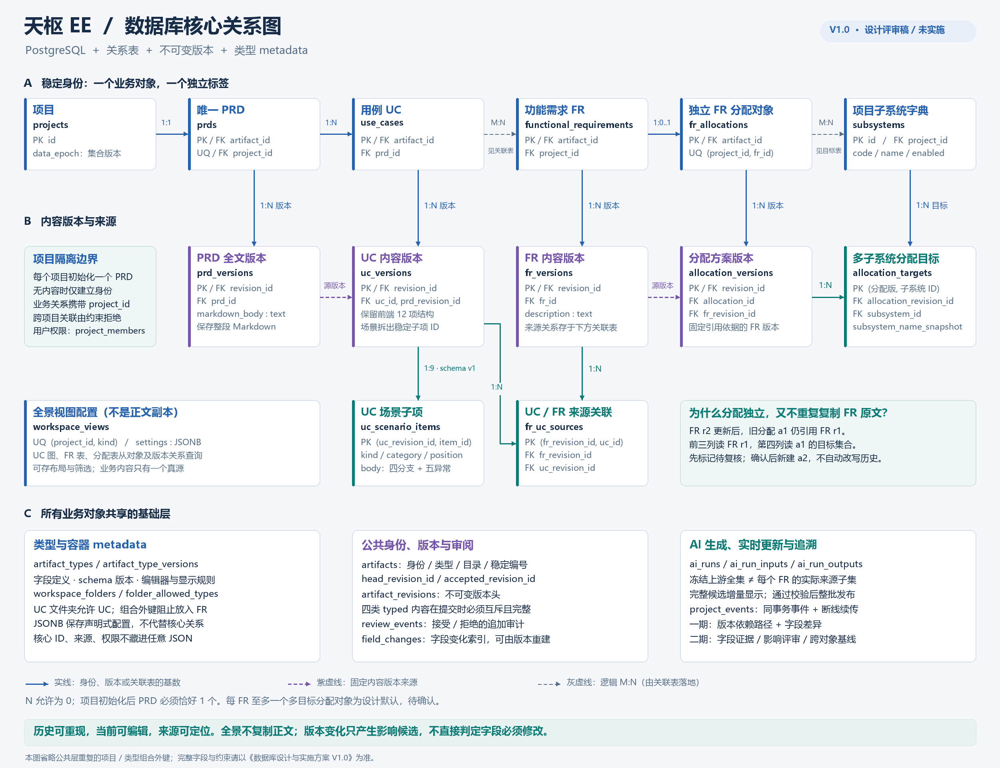
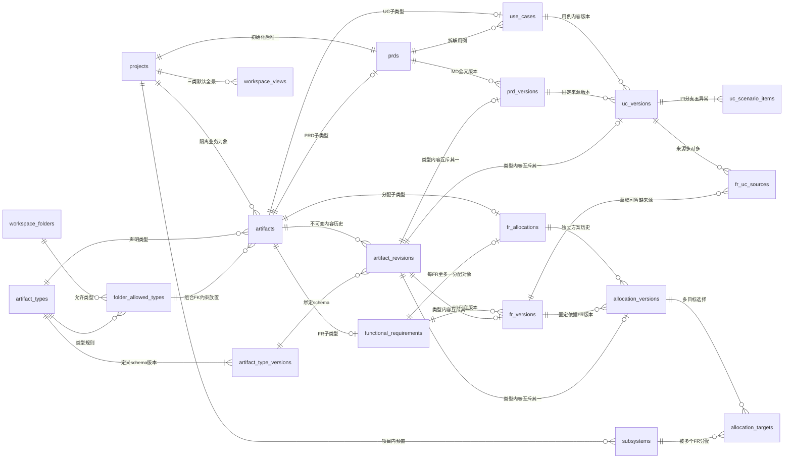
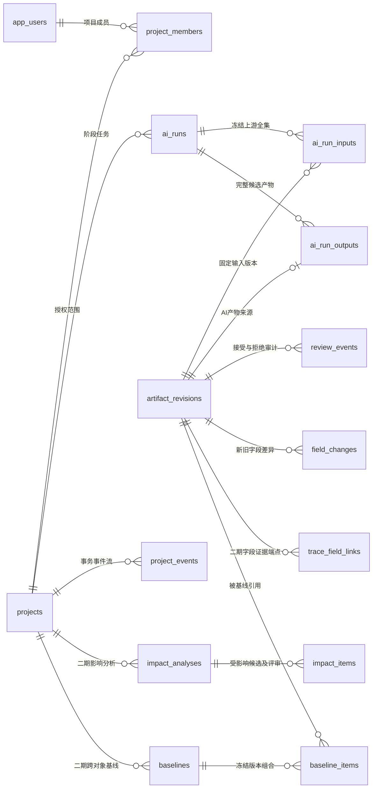

# 天枢 EE 智能开发平台：数据库设计与实施方案 V1.0

> 设计批次日期：2026-09-16  
> 状态：**设计评审稿，未建库、未执行 SQL、未修改前后端业务代码。**  
> 需求优先级：用户本次明确说明 > 现有前端模型 > 历史实施计划与效果图。  
> 推荐：PostgreSQL 18 + 关系表 + JSONB 类型元数据 + 不可变内容版本。不是把全部业务放进一个 JSON 文档，也不在一期引入图数据库。  
> 阅读顺序：先看第 1～4 节；开发看第 5～12 节；部署看第 13 节；评审与排期看第 14～16 节；**第 18 节为数据库图**。

## 1. 结论：用一句话描述这套设计

**项目是隔离边界，PRD / UC / FR / FR 分配是有稳定身份的业务对象；对象每次保存产生新版本，关系指向具体版本，视图从这些对象和关系生成。**

业务过程：

```text
项目的一句话需求
  → 项目唯一 PRD（完整 Markdown 字符串）
  → 多个 UC（UC 全景实时展示）
  → 分析项目全部有效 UC → 多个 FR（FR 全景实时展示）
  → 分析项目全部有效 FR → FR 分配对象 → 多个子系统
```

### 1.1 对九项要求的落实

| 用户要求 | 本设计的决定 |
|---|---|
| 多项目与各类项目数据 | 一库多项目；业务表、关系表均带 `project_id`，组合外键防止跨项目串联 |
| 每项目只有一份 PRD | 一个 PRD **身份**，任意多个历史版本；`UNIQUE(project_id)`，不因归档释放唯一性 |
| PRD 是 MD STRING | `prd_versions.markdown_body text` 保存原始全文，不强制拆章节字段 |
| PRD → 多 UC | 每条 UC 归属该项目唯一 PRD，UC 的每个版本记录实际依据的 PRD 版本 |
| UC ↔ FR 多对多 | `fr_uc_sources` 独立关联表，连接 FR 版本与 UC 版本，不使用逗号拼接编号保存关系 |
| FR ↔ 子系统多对多 | FR、FR 分配分表；每个 FR 对应一个分配对象，其每个版本有多个目标子系统 |
| 追溯和修改影响 | 不可变版本 + 版本级依赖 + 字段变更记录；二期增加字段证据与影响评审 |
| 类型和文件夹 metadata | 类型注册表 + JSON Schema + 文件夹允许类型关系；前后端可读，数据库能约束 |
| Ubuntu / 网络访问 / 实施 | PostgreSQL 官方 Ubuntu 包；应用走 HTTPS，数据库走内网或 VPN；分阶段落地 |

### 1.2 已确认与设计默认要区分

以下视为本次已确认：每项目一个 PRD、PRD 自由 Markdown、UC 固定结构、两处多对多、FR 与分配独立管理、需要 metadata 与追溯。

以下是**设计默认，仍可调整**：

- 项目创建时预建空 PRD 身份，但还没有正文版本；首次生成后仍是这个身份。
- 一份 FR 对应一个“FR 分配对象”，对象内可选择多个子系统，而不是每勾选一个子系统就新增一个分配标签。
- 生成下游前，全部有效上游必须存在且已接受；有未处理草稿时阻断并列出原因，不暗中漏掉它们。
- 分配页面只修改子系统集合，不在分配页面另改 FR 原文。
- 保存创建版本，接受是独立操作；新版本不会自动改写下游。
- 字段级追溯先做“哪些对象可能受影响”，不承诺仅靠外键自动推断精确字段的语义影响。

## 2. 与现有项目的对照，以及必须修正的旧假设

### 2.1 本次实际核对的文件

- `E:\Git projects\TS-frontend\src\features\uc\model.ts`
- `E:\Git projects\TS-frontend\src\features\fr\model.ts`
- `E:\Git projects\TS-frontend\src\features\workbench\model.ts`
- `E:\Git projects\TS-frontend\src\features\workspace\tree.ts`
- `E:\Git projects\TS-frontend\docs\标签页与左侧导航交互规范.md`
- `E:\Git projects\TS-frontend\docs\design-review\UC与FR分配全景设计说明_2026-09-16.md`
- `E:\Git projects\TS-backend\README.md` 与 `requirements.txt`

当前前端已有 UC 结构化详情与 FR 三字段模型；工作台允许多个业务功能 PRD。UC 全景图和 FR 分配全景在 2026-09-16 的记录中为 **Figma 已设计、前端未接入**。后端当前仍以认证与健康检查为主，未核对到已实施的业务数据库模型。

本设计采用用户本次最新规则，因此：

1. 不照搬现有 `featureId → 多 PRD` 的所有权结构。业务功能可保留为分类标签，不能再决定 PRD 数量。
2. `featureName` 不作为外键；对象归属于项目，通过稳定 UUID 连接。
3. 一个对象一个标签仍成立；但项目下只能有一个 PRD 对象标签，多个 UC、FR、分配对象可以同时打开。
4. 全景页是项目级视图：同项目 UC / FR / 分配各一个默认视图。筛选某个功能不会复制一套业务数据。
5. 数据库身份和显示编号分开。`FrContent.id` 当前存的是 `Fr-501-01-001`，未来映射为 `code`；不能直接当数据库 UUID。
6. FR `source: string` 未来由关联 UC 的编号渲染，底层必须传 `uc_id` / `uc_revision_id`；编辑来源应用对象选择器，不继续依赖任意文本。
7. 本次不把 Mock 的 13 条 FR、固定项目 A/B 或示例编号当成真实业务限制。

## 3. 数据库选型

### 3.1 推荐 PostgreSQL

建议新库使用 **PostgreSQL 18 的受支持补丁版本**。本次官方版本页列出 18.6；部署当天复核同一主版本的安全补丁，不将版本写成永远不更新的常量。[S1]

本项目的核心不是单纯存长文本，而是保证“一个项目一个 PRD”“多对多”“历史来源不能丢”“并发修改不覆盖”的一致性。采用 PostgreSQL 的关系约束保存核心事实，JSONB 只存有版本的元数据与扩展信息。PostgreSQL 支持 JSONB 及其索引，但 JSONB 自身不等于业务 JSON Schema 校验。[S2][S3]

以下为**面向本项目的架构取舍**，不是数据库产品的性能排名：

| 方案 | 本项目建议 |
|---|---|
| PostgreSQL | 首选，核心业务、版本、关系、任务记录集中管理，避免跨库一致性成本 |
| MySQL | 团队如已有成熟运维可重新评估；目前没有必须换用它的业务理由 |
| MongoDB | 不选作本系统主存储；无需为“PRD 是字符串、metadata 是 JSON”额外引入文档主库 |
| Neo4j 等图数据库 | 不作为一期依赖；先在关系库保留可靠的依赖边，图能力有瓶颈后再评估只读投影 |
| SQLite | 不作为本次 Ubuntu 多人网络部署的目标主库 |
| Redis / 向量库 | 不是当前建模必需品；缓存、向量检索另有明确需求再增加 |

版本关系可先用递归查询遍历；PostgreSQL 提供递归 CTE，足以作为本设计初期追溯实现手段。是否需要图数据库应由实际图规模与查询耗时决定。[S8]

### 3.2 组合方式

- 核心字段、ID、状态、项目归属、来源关系：关系表。
- PRD 全文、UC 文本、FR 描述：`text`，不存成 HTML，不把 Markdown 字符串再 JSON 转义一层。
- 类型定义、显示配置、非关键扩展：`jsonb`，服务端按固定 schema 校验。
- 图片附件若以后需要：对象存储保存二进制，数据库只保存受控引用；一期不主动引入文件上传能力。
- 所有数据放一个 PostgreSQL 数据库的业务 schema（建议 `ee`）；不按项目创建数据库或表。

## 4. 概念说明：对象、版本、视图与 metadata

| 概念 | 例子 | 应不应该单独保存 |
|---|---|---|
| 对象身份 | `FR-001` 是哪条需求 | 保存，UUID 永久稳定 |
| 内容版本 | `FR-001 r3` 的描述是什么 | 保存，不可变 |
| 版本关系 | FR r3 依据 UC-A r2、UC-B r5 | 保存，不能只指向“最新 UC” |
| 分配对象 | 对 FR-001 的子系统分配方案 | 独立保存，有自己的 ID、版本和审阅记录 |
| 分配目标 | 本版选择制动、座舱两个子系统 | 保存为多条目标关系，不是一个逗号字符串 |
| 全景视图 | FR 表、UC 用例图 | 保存视图身份与配置，正文从对象/关系查询 |
| metadata | “UC 有哪些字段”“UC 文件夹只允许 UC” | 保存类型与容器规则，不重复保存业务事实 |
| 标签页 | 用户当前打开 FR-001 | UI 状态；关闭不删除任何业务数据 |

**不要把数据库版本和 PostgreSQL 内部 MVCC 当成一回事。** 这里的 r1/r2/r3 是业务历史，必须显式建表保存。

### 4.1 为什么 FR 分配要独立，而又不直接复制一份 FR

例如：

```text
FR-001（稳定 ID）
 ├─ r1：当前来源 UC-A r2，描述“触发视觉提示”
 └─ r2：描述修改为“触发视觉和声音提示”

ALLOC-001（另一个稳定 ID，归属 FR-001）
 ├─ a1：依据 FR-001 r1 → 子系统 A
 └─ a2：依据 FR-001 r1 → 子系统 A、B
```

FR 发布 r2 后，a2 **仍明确依据 FR r1**，被标记为“上游已有变化，待检查”。用户确认后再创建 a3，绑定 FR r2。a1/a2 的历史不能被修改。

FR 分配表的前三列通过 `allocation_versions.fr_revision_id` 读取**被引用版本**的编号、来源、描述；第四列从 `allocation_targets` 聚合名称。这样满足 FR / 分配独立存储，又不会有两份可随意修改而互相冲突的 FR 原文。

如果将来允许子系统级需求细化，可在分配对象下另建“分解需求”类型，而不是让当前相同的描述字段悄悄变成另一种语义。

## 5. 表总览与统一约定

### 5.1 建议表清单

为避免一张万能 JSON 表，也避免每种类型复制整套版本系统，采用“公共对象层 + 四类业务子表”。总计 **28 张一期目标表**，分里程碑上线，不要求一次写完；另有 5 张二期追溯增强表。

| 组别 | 表 | 数量 | 职责 |
|---|---|---:|---|
| 项目与用户 | `app_users`, `projects`, `project_members` | 3 | 身份映射、项目、访问范围 |
| 类型与容器 | `artifact_types`, `artifact_type_versions`, `workspace_folders`, `folder_allowed_types` | 4 | metadata、schema、目录约束 |
| 公共对象与版本 | `artifacts`, `artifact_revisions` | 2 | 稳定身份与历史版本头 |
| PRD | `prds`, `prd_versions` | 2 | 每项目唯一 PRD 与全文 |
| UC | `use_cases`, `uc_versions`, `uc_scenario_items` | 3 | 用例与嵌套场景 |
| FR | `functional_requirements`, `fr_versions`, `fr_uc_sources` | 3 | 需求与多对多来源 |
| 分配 | `subsystems`, `fr_allocations`, `allocation_versions`, `allocation_targets` | 4 | 子系统及独立分配方案 |
| 全景 | `workspace_views` | 1 | 视图配置，不复制正文 |
| 生成过程 | `ai_runs`, `ai_run_inputs`, `ai_run_outputs`, `project_events` | 4 | 快照、幂等、增量更新 |
| 审阅与变更 | `review_events`, `field_changes` | 2 | 接受/拒绝审计、字段 diff |
| 二期增强 | `trace_field_links`, `impact_analyses`, `impact_items`, `baselines`, `baseline_items` | 5 | 字段证据、影响评审、基线 |

`v_fr_current`、`v_uc_current`、`v_allocation_current`、`v_lineage_edges` 是可选 SQL VIEW / 查询层名称，**不是上述额外业务表**。

### 5.2 字段与命名约定

- `id uuid`：应用生成的主键；业务编号单独 `code text`，不依赖会变更的名称。
- `project_id uuid NOT NULL`：所有项目数据、关系、任务与事件的隔离键。
- 时间采用 `timestamptz`，按 UTC 写入，前端按用户时区显示。
- `created_at`、`created_by`：创建时间与操作用户；系统生成由发起用户 + 任务 ID 共同解释。
- 身份表带 `updated_at`、`archived_at NULL`；版本与来源关系不物理覆盖。归档不是删除历史。
- `metadata jsonb NOT NULL DEFAULT '{}'`：仅用于约定的扩展；不能把关联 ID、权限或业务状态藏进去。
- 文本默认 `NOT NULL`；草稿允许空字符串的字段，由接受校验进一步收紧。`N/A` 保留原文，不强制转成 NULL。
- 枚举在 schema / Pydantic 和 DB CHECK 中统一，如 `PRD`, `UC`, `FR`, `FR_ALLOCATION`；界面名称仍是“FR分配”。
- `created_via`：`manual / ai / migration`；`ai_run_id NULL` 只在 AI 来源版本上存在。
- 本文 `PK` 为主键，`FK` 为外键，`UQ` 为唯一约束；子表下文省略的通用字段以本节为准。
- `source / subsystemNames` 等显示字段可由查询返回，但不能因此省去真实外键关系。

## 6. 核心表：字段与关系

### 6.1 用户与项目

#### `app_users`：业务操作人的稳定身份

| 字段 | 类型/约束 | 含义 |
|---|---|---|
| id | uuid PK | 操作人身份 |
| auth_subject | text UQ NOT NULL | 当前认证系统映射标识，不存 Cookie / JWT |
| display_name | text NOT NULL | 展示名称 |
| disabled_at | timestamptz NULL | 禁用时间；历史署名仍可读 |
| created_at | timestamptz | 建立时间 |

一期先映射既有登录用户，不要求因此重做注册、改密或 SSO。用户注销不级联删除需求历史。

#### `projects`

| 字段 | 类型/约束 | 含义 |
|---|---|---|
| id | uuid PK | 项目 ID |
| code | text UQ | 项目编号，不局限 A/B |
| name, description | text | 名称和说明 |
| initial_prompt | text | 一句话需求；各次实际 AI 输入仍进任务快照 |
| state | text CHECK | active / archived |
| data_epoch | bigint，初始 0 | 已发布数据集合变化序号，防止生成覆盖并发新改动 |
| event_sequence | bigint，初始 0 | 项目事件的持久递增计数，清理旧事件后也不重置 |
| metadata | jsonb | 非关键项目扩展 |
| created_by, created_at, updated_at, archived_at | 通用 | 创建与归档 |

`data_epoch` 在对象发布、接受状态变化、归档/恢复、子系统字典内容/启用状态变化时在同一事务中增加；不因阅读、图布局、逐字 token 增加。初期按项目整体校验，后续性能需要时再拆阶段 epoch。

#### `project_members`

`(project_id, user_id) PK/FK`，`role CHECK(owner/editor/viewer)`，`created_at`。所有 API 先鉴权再按项目查询。具体角色细分是后续可调的默认，不影响核心数据模型。

### 6.2 类型 metadata 和文件夹

#### `artifact_types`

`code text PK`（固定四种），`display_name text`，`description text`，`enabled boolean`。

只有类型注册，不允许用户随意上传代码就扩展可执行类型。

#### `artifact_type_versions`

| 字段 | 类型/约束 | 含义 |
|---|---|---|
| id | uuid PK | schema 版本 ID |
| type_code | text FK | UC / FR 等 |
| version | integer > 0，UQ(type_code, version) | 类型结构版本，不是业务内容 r 版本 |
| content_schema | jsonb | JSON Schema：API 内容结构校验 |
| field_catalog | jsonb | 稳定字段键、中文名、类型与 canonical path |
| ui_schema | jsonb | 展示顺序、编辑器类型、只读字段 |
| extra_metadata_schema | jsonb | 限定实例 metadata 可填什么 |
| created_at, created_by | 通用 | 定义发布信息 |

已发布定义不可原地改；字段升级创建 v2，旧内容继续绑定 v1；v2 的新必填字段不应使旧版本突然失效。真正的物理列变更仍要数据库迁移，不会“改 JSON 自动建表”。

#### `workspace_folders`

`id uuid PK`、`project_id FK`、`parent_id uuid NULL`、`name text`、`role text`（root/prd/uc/fr/fr_allocation/group）、`sort_order integer`、`metadata jsonb`、通用审计字段。

默认每项目初始化：项目根 / PRD / UC / FR / FR分配；分类角色是固定 code，中文名可变。默认不开放任意移动这些系统目录。父子必须同项目，禁止把自己及后代设为父目录；检查需事务/触发器，不能仅靠父 ID 外键。

#### `folder_allowed_types`

`(project_id, folder_id, type_code) PK`，分别 FK 到同项目文件夹和类型注册表。

例：UC 文件夹只有一行 `UC`；FR 文件夹只有 `FR`。`artifacts(project_id, folder_id, type_code)` 直接 FK 到这个组合，所以即使跳过前端也不能把 FR 插进 UC 文件夹。

文件夹规则是唯一真源；返回给前端的 `allowedTypes: ["UC"]` 由此表生成，**不在 metadata 内再维护第二份规则**。一旦存有对象，不可直接删除对应允许类型；迁移规则需要显式迁移已有对象。

### 6.3 公共对象身份与版本头

#### `artifacts`

| 字段 | 类型/约束 | 含义 |
|---|---|---|
| id | uuid PK | PRD / UC / FR / 分配的统一对象 ID |
| project_id | uuid FK | 项目归属 |
| type_code | text FK | 四类业务对象之一；身份建立后不可改类型 |
| folder_id | uuid FK（组合） | 受类型限制的存放目录 |
| code | text；UQ(project_id, type_code, code) | 稳定显示编号，创建后不可改、归档不重用 |
| head_revision_id | uuid NULL FK（同对象） | 最新已发布工作版本，尚未生成时 NULL |
| accepted_revision_id | uuid NULL FK（同对象） | 最近接受版本；新草稿不擦除它 |
| lock_version | bigint | 编辑/审阅 CAS 乐观锁 |
| metadata | jsonb | 可选分类、标签等；不藏核心关联 |
| created_at, created_by, updated_at, archived_at | 通用 | 审计与软归档 |

编号沿用现有前端的只读规则；若未来开放重编号，需要另加版本编号快照/别名映射，不能直接改 code 导致历史展示一起变化。

`title` 不复制到 artifacts 作独立可编辑字段：UC 名称读其内容版本；PRD 标题可从 MD 显示提取，FR 标签可用编号 + 摘要。需要列表缓存时必须明确是可重建缓存。

#### `artifact_revisions`

| 字段 | 类型/约束 | 含义 |
|---|---|---|
| id | uuid PK | 内容版本 UUID |
| project_id, artifact_id, type_code | 组合 FK | 归属与类型，防止串项目/串类型 |
| revision_no | bigint > 0；UQ(artifact_id, revision_no) | r1/r2/r3，仅对该对象递增 |
| base_revision_id | uuid NULL FK（同对象） | 从哪一版修改来；首版 NULL |
| type_version_id | uuid FK（匹配 type_code） | 内容遵循哪个类型 schema |
| content_hash | text | 对规范化内容及关键关系的摘要；不是加密或鉴权 |
| created_via | text CHECK | manual / ai / migration |
| ai_run_id | uuid NULL FK（同项目） | AI 生成来源 |
| change_summary | text | 本次修改说明 |
| extra_metadata | jsonb | 本版本扩展信息快照 |
| created_by, created_at | 通用 | 谁何时创建 |

只保存版本头，不放第二份整套 UC / FR 可编辑 JSON。具体内容在对应子表；一次事务必须写齐版本头、类型子表、嵌套项、来源关系。已完成版本不 UPDATE / DELETE；运行账号无直接修改历史权限。

### 6.4 PRD：唯一对象与 Markdown 全文

#### `prds`

`artifact_id uuid PK/FK(PRD artifacts)`，`project_id uuid NOT NULL UQ/FK(projects)`。

创建项目的事务同时建立 PRD artifact 和 prds 行；无正文时两个版本指针均 NULL。唯一约束只保证“最多一份”，**“必须有一份”由项目创建原子事务 + 延迟完整性检查保证**。事务提交后不允许出现只有项目、没有 PRD 身份的状态。

#### `prd_versions`

`revision_id uuid PK/FK(PRD artifact_revisions)`，`project_id, prd_id` 组合关联身份，`markdown_body text NOT NULL`。

用户保存 MD 时保存原文；不强制固定标题、字段或卡片数。`metadata`、版本号、作者是系统属性，不是给 PRD 正文划字段。渲染时限制原始 HTML/脚本，避免存储文本导致 XSS。

### 6.5 UC：对齐前端 12 个字段

#### `use_cases`

`artifact_id uuid PK/FK(UC artifacts)`、`project_id FK`、`prd_id uuid FK(同项目 prds)`。

一份 PRD 下可有任意多条 UC；不能将 UC 挂到别的项目 PRD。

#### `uc_versions`

| 前端字段 / 业务字段 | 数据库存储 | 说明 |
|---|---|---|
| 系统版本 | revision_id PK，project_id，uc_id | 关联 UC 版本头 |
| 来源 PRD 版本 | prd_revision_id uuid FK | **该版 UC 真正依据的 PRD 版**，且必须属于 use_cases.prd_id |
| 用例名称 `name` | name text | 原文 |
| 用例描述 `description` | description text | 原文 |
| 用例编号 `number` | artifacts.code | 稳定编号，不额外在 UC 版本内写一份 |
| 参与者 `actors` | actors_text text | 保留当前前端自由文本 |
| 前置条件 `preconditions` | preconditions text | 保留换行与表达式 |
| 场景 `mainFlow` | main_flow text | 主事件流 |
| 场景 `branches` | uc_scenario_items(kind=branch) | 当前 4 个分支，排序返回 |
| 场景 `exceptions` | uc_scenario_items(kind=exception) | 当前 5 种异常，排序返回 |
| 后置条件 `postconditions` | postconditions text | 原文 |
| 扩展用例 `extensions` | extensions_text text | 当前保留文本；确有关系后再结构化 |
| HMI 交互逻辑 `hmi` | hmi_logic text | 原文 |
| 法规需求 `regulations` | regulations text | 保存用户/AI 原文，不视为已核实法规结论 |
| 性能需求 `performance` | performance text | 不把示例阈值当事实 |
| 非功能需求 `nonfunctional` | nonfunctional text | 原文 |

主流程、分支、异常合起来是**一个“场景”顶层字段**，因此界面仍是 12 项，不是新增了若干业务字段。

#### `uc_scenario_items`

| 字段 | 类型/约束 | 含义 |
|---|---|---|
| project_id, uc_id, uc_revision_id | 组合 FK | 归属 UC 的某版本 |
| item_id | uuid | 场景项稳定 ID，修改/重排复用，新增才创建 |
| kind | text CHECK | branch / exception |
| category | text | 分支槽位 a1～a4；异常五个固定 code |
| position | integer ≥ 0 | 版本内显示次序，不作为身份 |
| body | text | 场景原文 |

PK `(uc_revision_id, item_id)`；UQ `(uc_revision_id, kind, category)`、`(uc_revision_id, kind, position)`。

异常类别固定映射：`vehicle_state / mechanical / environmental / misuse / power`，对应车辆状态异常、机械故障、环境突变、用户误操作（滥用）、供电异常。

当前 schema v1 要求 4 个 branch、5 个 exception，包括 `N/A` 行；未来可用 schema v2 放宽分支数，数据库不建 branch_1～branch_20 列。场景项数量是跨行规则，须在发布/接受事务完整性校验中验证，不能用普通行级 CHECK 冒充完成。[S3]

接口兼容层可把场景项投影回当前 `string[4]` / `string[5]`。为了字段追溯，新 API 同时返回 item_id，不能用数组下标当跨版本标识。

### 6.6 FR：内容与多对多来源

#### `functional_requirements`

`artifact_id uuid PK/FK(FR artifacts)`、`project_id FK`。没有单一 `uc_id`，因为同一 FR 可以来自多个 UC。

#### `fr_versions`

`revision_id uuid PK/FK(FR artifact_revisions)`、`project_id, fr_id` 组合归属，`description text NOT NULL`。

FR 页面三字段对应：

- 需求编号：`artifacts.code`。
- 需求来源：`fr_uc_sources` 关联的 UC 编号集合，API 返回结构化 sources 后再渲染。
- 需求描述：`fr_versions.description`。

#### `fr_uc_sources`

`project_id`、`fr_revision_id FK`、`uc_id FK`、`uc_revision_id FK`、`rationale text`（为什么关联）、`created_via`。

PK `(fr_revision_id, uc_id)`；同一 FR 版本对同一 UC 只引用一个版本；组合外键验证 uc_revision_id 确属于该 uc_id 和同项目。

示例：

| FR 版本 | UC 身份 | 实际引用的 UC 版本 |
|---|---|---|
| FR-001 r1 | UC-001 | r2 |
| FR-001 r1 | UC-002 | r4 |
| FR-002 r1 | UC-002 | r4 |

既表达 UC↔FR 多对多，也保留来源历史。删除 FR-001 r2 的某个来源时创建新版本对应的新集合，不删除 r1 来源记录。

**任务读取了全部 UC，不表示每条生成 FR 都来源于全部 UC。** `ai_run_inputs` 保存分析输入全集；`fr_uc_sources` 保存逐 FR 的实际依据子集，两者不可混用。

草稿允许暂缺来源，但标为不完整；接受必须至少一个有效来源，除非后续明确允许无 UC 的独立 FR。跨项目来源始终禁止。

### 6.7 FR 分配：独立对象 + 目标关系

#### `subsystems`

`id uuid PK`、`project_id FK`、`code text`、`name text`、`description text`、`enabled boolean`、`catalog_version integer`、`created_at, updated_at`，UQ `(project_id, code)`。

先采用项目内子系统字典，可由系统预置模板复制；不新增用户维护入口。真实子系统清单待用户确认，示例不能自动成为正式目录。

已被引用的子系统只停用，不物理删除；重命名不改变 ID。若未来要全局共用，再拆 `subsystem_catalog` + `project_subsystems`，不要现在凭同名跨项目关联。

#### `fr_allocations`

`artifact_id uuid PK/FK(FR_ALLOCATION artifacts)`、`project_id FK`、`fr_id uuid FK(同项目 functional_requirements)`，UQ `(project_id, fr_id)`。

FR 和分配是两行不同的 artifacts + 两张不同的类型身份表。分配有独立的 `ALLOC-xxx` 内部编号和标签；全景前三列显示**源 FR 编号**，不是把 ALLOC 编号塞进需求编号列。

#### `allocation_versions`

`revision_id uuid PK/FK(FR_ALLOCATION artifact_revisions)`、`project_id, allocation_id` 组合归属、`fr_id uuid`、`fr_revision_id uuid FK`、`note text`。

必须验证引用的 FR 版本属于分配对象的 fr_id；不能把 ALLOC-001 改挂另一条 FR。`note` 是可选内部说明，不新增本轮前端表格列。

#### `allocation_targets`

`project_id`、`allocation_revision_id FK`、`subsystem_id FK`、`subsystem_name_snapshot text`、`rationale text`，PK `(allocation_revision_id, subsystem_id)`。

一个分配版本多条 targets，实现一个 FR 多目标；一个子系统出现在多个 FR 分配中，实现多对多。`subsystem_name_snapshot` 是刻意保留的历史名称快照，不是第二份可编辑子系统字典。

- 保存目标集合 `[A,B] → [B,C]`：新建 allocation r2 与两个 targets，旧 r1 保留。
- 当前版本可直接聚合两个标签，也可在导出时展开多行；不是存成字符串 `"A,B"`。
- 清空为 0 个目标，设计默认可保存为待处理，但不可接受；如果业务需要合法“不适用”，以后增加明确理由，不用空值猜测。
- 删除/停用 B 不删除历史 targets；新接受版本必须校验当前目标可用性。
- FR 原文编辑仍去 FR 对象；分配页面改子系统不反向覆盖 FR 描述。

### 6.8 全景视图配置

#### `workspace_views`

`id uuid PK`、`project_id FK`、`kind CHECK(UC_OVERVIEW/FR_OVERVIEW/ALLOCATION_OVERVIEW)`、`name text`、`renderer_key text`、`renderer_version integer`、`settings jsonb`、`lock_version bigint`、`created_at, updated_at`，UQ `(project_id, kind)`。

只存列表列顺序、筛选条件、图布局策略等；不存一份可独立编辑的 rows/body。返回的 UC 节点、FR 行、分配目标来自业务表和指定版本模式，源数据一改视图自然变化。

UC 用例图：节点 ID 用 UC 对象 UUID，标签来自当前 UC name；参与者原文可在节点说明显示。**自由文本 actors/扩展用例不等于结构化 UML 关系**；若要自动画多角色连线、include/extend，需要定义经过校验的角色/关联投影，不能随便按逗号分割或让布局引擎猜测。一期先提供用例节点与可确定的角色投影；不确定的关系只显示文本提示，详细角色关系模型列入待确认项。

图布局坐标若保存，节点引用用 UUID，配置带 `source_epoch`；过期坐标可丢弃重算。它不是 UC 内容的另一来源。本轮既有“图节点不可编辑、无 UC–FR 连线”限制仍保留。

## 7. AI 生成任务、输入快照与实时更新

### 7.1 任务表

#### `ai_runs`

| 字段 | 类型/约束 | 作用 |
|---|---|---|
| id | uuid PK | 任务标识 |
| project_id | uuid FK | 项目隔离 |
| stage | text CHECK | PRD / UC / FR / FR_ALLOCATION |
| status | text CHECK | queued / running / ready / succeeded / failed / cancelled / conflict |
| operation | text CHECK | generate / revise / analyze；检查任务可无产物 |
| target_artifact_id | uuid NULL，同项目 FK | 单对象修改目标；批量生成为空 |
| prompt_text | text | 用户本次实际输入 |
| prompt_template_version, model_id | text | 模板和模型配置记录，不在这里保存 API Key |
| parameters | jsonb | 温度等非敏感参数、算法版本 |
| catalog_snapshot | jsonb | 分配任务使用的子系统 ID/名称/启用状态与字典版本快照 |
| base_epoch | bigint | 冻结输入时项目 data_epoch |
| input_set_hash | text | 排序后的全部输入对象 ID/版本 ID 及阶段策略摘要 |
| idempotency_key | text；UQ(project_id, idempotency_key) | 同一次请求重试不会重复创建 |
| retry_of_run_id | uuid NULL，同项目 FK | 真正重新执行另建任务，保留失败来源 |
| lease_owner, lease_expires_at, attempt_no | text / timestamptz / integer | worker 租约，宕机恢复与接管 |
| progress, error_code, error_detail | 数值 / text | 进度和可读失败原因 |
| requested_by, created_at, started_at, finished_at | 通用 | 操作人和生命周期 |

不在数据库事务里等待模型响应；输入读取完成后关闭事务，AI 在事务外执行。

#### `ai_run_inputs`

`project_id`、`run_id FK`、`artifact_id FK`、`revision_id FK`、`role CHECK(primary/context)`，PK `(run_id, artifact_id)`。版本必须属于对应对象和项目。

- 生成 UC：一行项目 PRD 的接受版本。
- 生成 FR：项目全部有效 UC，每个对象恰好一个接受版本。
- 生成分配：项目全部有效 FR，每个对象恰好一个接受版本；子系统配置另冻结到 catalog_snapshot。
- 额外参考的业务对象标为 context，不自动变成实际业务来源。附件不是本期四类 artifact，未来另加附件表和任务附件关联，不能把附件 ID 写入 artifact_id 外键。

来源校验要求：生成 UC 的 prd_revision_id 必须属于任务 primary 输入；生成 FR 的每条 fr_uc_sources 必须引用冻结的 primary UC 版本；生成分配的 fr_revision_id 同理，目标必须属于 catalog_snapshot 且发布/接受时仍可用。不能只校验 UUID 存在就接受模型虚构的来源。

集合冻结时先锁项目行，再读取身份、归档状态和版本指针；所有业务发布事务遵守同一锁协议，得到一致输入集合。输入集合为空、缺接受版本或存在较新未接受版本时，不调用 AI，返回明确阻断清单。设计默认还检查上游对象自身的来源是否过期：有已知未处理的上游变更时不能仅凭“已接受”放行，先复核并生成绑定新来源的接受版本；是否允许显式豁免并保留评审证据，随 DB-Q01/Q04 确认。

#### `ai_run_outputs`

`project_id`、`run_id FK`、`output_key text`（流中的稳定产物键）、`artifact_id`、`revision_id`、`base_revision_id NULL`、`operation CHECK(create/revise)`、`state CHECK(staged/published/rejected)`、`created_at`。

PK `(run_id, output_key)`；UQ `(run_id, artifact_id)`、`UQ(revision_id)`；一个任务对同对象至多一个最终候选版本，一个候选版本只归属一次生成任务。所有版本 FK 校验对象与类型归属；还须校验对应 artifact_revisions.ai_run_id 等于当前 run_id。

**现有对象版本沿用原 artifact_id。** 新对象先预留 UUID，只有明确新增才创建。不能用编号/名称模糊匹配来覆盖现有对象；AI 未输出的旧对象也不能默认删除。

#### `project_events`

`project_id`、`sequence bigint`、`event_id uuid UQ`、`event_type text`、`artifact_id NULL`、`revision_id NULL`、`run_id NULL`、`data_epoch bigint`、`payload jsonb`、`created_at`、`dispatched_at NULL`，PK `(project_id, sequence)`。

项目 sequence 在持有项目行锁的短事务内通过 projects.event_sequence 递增分配，用于提交后的事件顺序与断线续传；不直接拿全局 UUID 或裸 sequence 分配时间冒充提交顺序。事件只放通知必要信息，客户端按 ID 查询授权数据，不在公开事件里广播整份需求。

**作为事务 outbox 使用**：业务落库和通知事件同事务；提交后 worker 投递 SSE/WebSocket。投递至少一次，客户端按 event_id/sequence 去重；旧事件过期时返回“需要全量同步”，不能返回不完整历史却声称已同步。

### 7.2 “实时更新”怎么做到又不污染正式数据

建议把“流式候选预览”和“已发布工作版本”区分，避免一半 JSON 成为真实 UC：

1. token 到达时只展示聊天生成进度；不每个 token 创建一个需求版本。
2. 一条完整 UC / FR / 分配产物到达并通过结构校验后，写入**不可变候选版本**、必要关系和 ai_run_outputs(staged)，发 `candidate_ready` 事件。
3. 全景接口在“生成中预览”模式读取：已发布 head + 当前任务 staged 候选覆盖层。候选按 output_key/对象 ID 去重，UC 图增量加节点，FR 表增量加行。
4. 页面明确显示“生成中 / 候选”，候选不能接受或用于下一阶段，也不改变其他已打开对象的正式 head。
5. 整批结束后，在短事务中验证来源集合、项目 base_epoch、各输出 base_revision_id、类型和所有关系。合法则原子更新各 head 指针、输出 state，增加 data_epoch，写发布事件。
6. 发布后对象为待接受，用户仍可手动编辑；不会自动推进下一阶段。
7. 失败/取消：保留候选供任务回看，但从默认全景去掉覆盖层；正式 head 不变。不把“生成了 6/13 条”伪装为成功的全集。
8. 后续若产品希望“部分结果也可接受”，应设计显式部分提交操作；不把当前默认静默改成半批提交。

这仍满足实时看到 UC 图 / FR 表 / 分配结果，不等于每个半成品都成为下游依据。生成中的候选身份可出现在任务预览区；普通工作空间目录默认只列有 published head 的对象，避免异常中断留下幽灵对象。

### 7.3 重新生成与编辑的并发

- 用户编辑提交 `expected_head_revision_id + lock_version`，数据库在事务内比较；不一致返回 409，保留用户文本供比较。
- AI 任务在 UC r2 上开始，执行中用户保存 r3：旧任务结果进入 conflict，不覆盖 r3，也不抢切当前标签。
- 即使每个旧输入版本都仍在，期间新增/归档了 UC 也意味着“全部 UC”集合变化。必须比较 base_epoch / input_set_hash，而不只检查旧输入是否删除。
- 相同项目同一阶段初期仅允许一个活跃生成任务，用 `(project_id, stage)` 的部分唯一索引限制 queued/running/ready；跨阶段并发输出由最终 epoch 检测保护。
- worker 租约过期后可恢复任务，但一次正式 publish 要通过 CAS 和幂等校验；先获得新的有效租约再提交。
- 版本号在持有该 artifact 行锁时分配，或以唯一约束冲突重试；不能裸用 `MAX(revision_no)+1`。
- 一次批量发布按固定顺序锁项目和对象，失败整体回滚；大批处理的性能和事务时长在验收数据规模下实测。

## 8. 保存、接受、归档与追溯

### 8.1 审阅状态不能混进正文

#### `review_events`

`id uuid PK`、`project_id`、`artifact_id`、`revision_id`、`sequence bigint`、`decision CHECK(accept/reject/withdraw)`、`actor_id`、`reason text`、`created_at`；UQ `(revision_id, sequence)`，所有操作 append-only。

- 新生成/保存后无 accept 事件：待处理。
- 接受：校验所审版本仍为 head、必填项和上游条件通过，原子追加 accept 事件、更新 accepted_revision_id、增加 data_epoch。
- 编辑已接受内容：允许创建新工作版本；accepted_revision_id 保留旧接受版，head 指向新草稿；下游因存在待处理变化而阻断。
- 拒绝当前草稿：记录 reject/withdraw 事件，head 可回退最近有效接受版；无接受版的对象归档或恢复空状态；不删除版本。
- 普通“取消编辑 / 不保存并关闭”不建新版本，不是 reject 对象。关闭标签是 UI 行为，不调用删除 API。
- 是否允许撤销一个已被下游使用的接受决定需产品确认。默认不能使历史消失，只记录撤销及影响检查。

**状态拆开表达**：`content_review_state`（待处理/已接受）、`archived_at`（是否有效）、`has_newer_upstream`（来源已变化）、`impact_state`（影响评审结果）不是同一个 status 枚举。

### 8.2 字段变更记录

#### `field_changes`

`id uuid PK`、`project_id`、`artifact_id`、`from_revision_id NULL`、`to_revision_id`、`field_key text`、`item_id uuid NULL`、`change_kind CHECK(add/remove/replace/reorder)`、`before_value jsonb`、`after_value jsonb`、`created_at`。

`from_revision_id/to_revision_id` 必须同项目、同 artifact_id；from 非空时须为较早版本。field_key 按相应旧/新 type_version 校验；新增字段校验新版、移除字段校验旧版，场景 item_id 也必须属于相应版本。

`field_key` 来源于类型 field_catalog，不是任意拼接的中文显示名。例如：

- `uc.name`
- `uc.scenario.mainFlow`
- `uc.scenario.branch.body + item_id=...`
- `fr.description`
- `fr.sources`（UC 版本 ID 集合）
- `allocation.targets`（子系统 ID 集合）
- `allocation.sourceFrRevision`
- `prd.markdownBody`

字段 diff 是从两版完整内容和版本关系计算的索引，真源仍是不可变快照；可以重建。对较长 Markdown 可保存摘要/区间索引而非两份全文，区间必须绑定具体版本；不能拿 r1 行号直接定位 r8。

### 8.3 一期已有的版本级依赖，不额外维护第二张可编辑边表

逻辑查询 `v_lineage_edges` 使用 UNION 派生：

```text
PRD版本 → UC版本：uc_versions.prd_revision_id
UC版本  → FR版本：fr_uc_sources
FR版本  → 分配版本：allocation_versions.fr_revision_id
分配版本 → 子系统：allocation_targets
```

历史模式读取指定版本边；当前模式先取 artifacts 的 head 或 accepted 指针，再读取各自的边。不要把所有历史版本的边混成当前图，导致关系已移除的 FR 仍永远显示受影响。

上游 UC 改动会：

1. 找到当前有效 FR 中，来源还依赖旧 UC 版的需求。
2. 找到依赖这些 FR 当前/被引用版本的分配方案及子系统。
3. 对依赖中间 FR 历史版的分配也返回“间接候选”，说明路径版本，不能仅因 FR 当前头换版就漏查旧分配。
4. 向上反查得到该 UC 当时依据的 PRD 源版本与可能需要检查的章节。
5. 上游 PRD 被列为来源/一致性检查项，**不是 UC 改了就自动推定 PRD 必须改**。
6. 给出候选路径、已变化字段和依据，最终影响判断由人工/AI分析确认。

还要区分两类风险：

- **直接依赖过期**：FR 实际引用 UC r2，UC 现为 r3，可确定“源版本变化”。
- **生成集合过期**：FR 生成时分析全部 UC，其中未建立实际来源边的 UC 后来新增/变化，无法仅靠边证明无影响。通过 ai_run_inputs/input_set_hash 标记“输入集合已变化”，保守提示重新检查该生成批次的有效 FR，不能漏掉这种集合级风险。

### 8.4 二期字段级影响分析（5 张增强表）

| 表 | 关键字段 | 作用 |
|---|---|---|
| trace_field_links | id、project_id、upstream_revision_id、upstream_field_key、upstream_item_id、downstream_revision_id、downstream_field_key、downstream_item_id、evidence、confidence、method、reviewed_by、created_at | 保存哪版上游字段支持哪版下游字段的证据；不取代核心来源关系 |
| impact_analyses | id、project_id、changed_artifact_id、from_revision_id、to_revision_id、scope_epoch、status、created_by、created_at | 一次可回看的影响检查任务 |
| impact_items | id、project_id、analysis_id、affected_artifact_id、affected_revision_id、direction、field_key、path_evidence(jsonb)、reason、assessment、resolved_by_revision_id、reviewed_by、reviewed_at | 对象/字段候选与评审处理，标记 potential/confirmed/no_impact/resolved |
| baselines | id、project_id、name、created_by、created_at | 冻结一次跨对象的项目基线 |
| baseline_items | project_id、baseline_id、artifact_id、revision_id；PK(baseline_id, artifact_id) | 保存 PRD/UC/FR/分配的固定版本组合 |

`trace_field_links` 引用必须同项目、字段必须在对应 type_version 的 field_catalog 中、场景 item 必须存在于被引用的那版 UC；建立 derive 证据还必须由核心来源边支持。`method` 标明 human/ai/rule，AI confidence 不是正确性保证。不存在可靠字段边时退化到对象级提示，不虚构精确字段。

示例：UC 的 `performance` 从“响应≤500ms”改成“响应≤300ms”（仅举例，不是工程指标）。只有当存在“UC performance → FR description”的证据时，系统才能定位那条描述候选；没有证据时只能说相关 FR、分配可能要复核。PRD 是自由 MD，可以绑定具体版本的引用片段/标题摘要；无法保证任意编辑后仍有稳定章节 ID。

基线创建需验证依赖闭包：基线中的 FR 引用了 UC r2，就不能同时声明 UC r3 是该基线的唯一依据而不解释差异；默认要求所选下游依赖均包含相应源版本，每对象只选一个版本，冲突时阻断基线建立。

影响评审本身也会过期：评审“无影响”仅对分析中的版本和 scope_epoch 有效；上游/下游再次修改应重开检查，不继承永久无影响标签。

## 9. metadata 示例：让目录和对象能够自描述

### 9.1 三层 metadata

1. **类型定义**：UC 是什么、有哪些字段、字段顺序和编辑器。
2. **实例元数据**：某个 UC 属于哪个项目、当前版本、扩展分类。核心属性从关系列投影，不重复作为自由 JSON 写入。
3. **文件夹元数据**：容器接受哪种对象，由 folder_allowed_types 生成。

JSON Schema 采用 2020-12 作为建议版本；这是 schema 约定，不是“用了 JSONB 就自带”的功能。[S9]

### 9.2 UC 类型定义示例（元数据接口返回，非直接执行代码）

```json
{
  "typeCode": "UC",
  "schemaVersion": 1,
  "displayName": "用例",
  "contentFormat": "structured",
  "editorKey": "uc-table-v1",
  "fields": [
    {"key": "uc.name", "label": "用例名称", "valueType": "string", "path": "/name"},
    {"key": "uc.description", "label": "用例描述", "valueType": "string", "path": "/description"},
    {"key": "object.code", "label": "用例编号", "valueType": "string", "readOnly": true},
    {"key": "uc.actors", "label": "参与者", "valueType": "string", "path": "/actors"},
    {"key": "uc.preconditions", "label": "前置条件", "valueType": "string", "path": "/preconditions"},
    {"key": "uc.scenario", "label": "场景", "valueType": "object", "path": "/scenario"},
    {"key": "uc.postconditions", "label": "后置条件", "valueType": "string", "path": "/postconditions"},
    {"key": "uc.extensions", "label": "扩展用例", "valueType": "string", "path": "/extensions"},
    {"key": "uc.hmi", "label": "HMI 交互逻辑", "valueType": "string", "path": "/hmi"},
    {"key": "uc.regulations", "label": "法规需求", "valueType": "string", "path": "/regulations"},
    {"key": "uc.performance", "label": "性能需求", "valueType": "string", "path": "/performance"},
    {"key": "uc.nonfunctional", "label": "非功能需求", "valueType": "string", "path": "/nonfunctional"}
  ],
  "scenarioRules": {"branchCount": 4, "exceptionCount": 5, "itemIdentity": "itemId"},
  "extraMetadataSchema": {
    "type": "object",
    "properties": {"tags": {"type": "array", "items": {"type": "string"}}},
    "additionalProperties": false
  }
}
```

以上 field 列表是用于说明的顶层显示定义；正式 field_catalog 还需列出 `uc.scenario.mainFlow`、`uc.scenario.branch.body`、`uc.scenario.exception.body` 等子字段键。`content_schema` 应为独立完整 JSON Schema，不能把此示例当成完整可执行校验器。

### 9.3 其他类型的规则

| 类型 | content_schema 的关键结构 | UI metadata |
|---|---|---|
| PRD | markdownBody:string | Markdown 编辑器；不定义正文业务字段 |
| UC | 12 项的内容投影，scenario 内含 mainFlow / branch items / exception items | 按表 7 结构展示，编号只读 |
| FR | description:string, sources:[{ucId, ucRevisionId}] | 三列，来源用选择器，编号来自 identity |
| FR_ALLOCATION | sourceFrRevisionId, targetSubsystemIds:uuid[] | 四列；前三列派生只读，子系统多选 |

完整实例响应示例：

```json
{
  "id": "02dd5539-9af1-471f-8125-0c3e4afef122",
  "projectId": "2f0e6a8f-4fa6-49d4-ae80-f822f8056dc9",
  "type": "FR",
  "code": "FR-501-01-001",
  "revisionNo": 3,
  "schemaVersion": 1,
  "reviewState": "pending",
  "content": {
    "description": "需求原文……",
    "sources": [{"ucId": "04dd5539-9af1-471f-8125-0c3e4afef122", "ucRevisionId": "05dd5539-9af1-471f-8125-0c3e4afef122", "code": "UC-501-01-04"}]
  },
  "metadata": {"tags": ["前方碰撞预警"]}
}
```

UUID 为说明示例；上述响应可由多表 JOIN 形成，不是一行 JSONB 全量落库的要求。`sources.code` 只展示，写入校验用 UUID。

### 9.4 文件夹 metadata

```json
{
  "folderId": "06dd5539-9af1-471f-8125-0c3e4afef122",
  "name": "UC",
  "role": "uc",
  "metadata": {
    "nodeKind": "folder",
    "allowedTypes": ["UC"],
    "isSystemFolder": true,
    "defaultViewKind": "UC_OVERVIEW"
  }
}
```

这里 `allowedTypes/isSystemFolder/defaultViewKind` 是受控列与类型规则的**只读投影**，客户端不能通过改一段 metadata 把自己升级为管理员或放开目录类型。

### 9.5 校验层次

| 层次 | 做什么 | 不做什么 |
|---|---|---|
| 前端 | 根据 metadata 给出编辑控件与即时提示 | 不作为安全边界 |
| FastAPI / Pydantic + schema validator | 类型、必填、数组长度、字段升级、语义关系和项目权限 | 不把任意 metadata 当 SQL / Python 执行 |
| PostgreSQL | FK、UQ、同项目、类型组合、行值约束、必要的延迟完整性检查 | 不用普通 CHECK 验证其他表内容 |

metadata 只允许声明式规则、白名单 editorKey，不允许内置 eval、脚本、动态 SQL。允许哪些类型是项目规则；有没有编辑权限仍由 project_members / 鉴权决定。

## 10. 不可省略的数据库约束

本节列的是**将来迁移必须实现的契约**，不是声称数据库已经具备这些约束。

### 10.1 项目、对象、类型和版本一致性

1. 四类业务身份子表建立 `UQ(project_id, artifact_id)`；`artifacts` 建立 `UQ(project_id,id,type_code)`，按外键需要补 `UQ(project_id,id)`；workspace_folders、subsystems、ai_runs 等被项目组合引用的表建立 `UQ(project_id,id)`。
2. `artifact_revisions(project_id,artifact_id,type_code)` 组合 FK → artifacts；另建 `UQ(project_id,artifact_id,id)` 和含 type_code 的组合候选键供类型子表引用。
3. 每种身份/版本子表携带固定 `type_code`，用 CHECK/固定值配合组合 FK。例如 uc_versions 只能引用 UC 类型的 artifact_revisions，不能引用 FR 版本。
4. `head_revision_id/accepted_revision_id` 通过 `(project_id,id,revision_id)` 指向同对象的版本；使用可延迟 FK 支持新身份初始 NULL 和一个事务内补齐，不能只验证 revision_id 全局存在。
5. identity 与 typed identity、version head 与 typed content 必须恰好对应一类；子表 PK 只能限制“至多一个”，**不存在子表时的完整性要用可延迟约束触发器/受控发布函数补齐检查**。
6. PRD 唯一性：`prds.project_id UNIQUE` + artifacts 中 PRD 类型项目唯一索引；项目初始化完成后存在性检查确保正好一个。归档时不释放。
7. UC 的 prd_id 与 uc_versions.prd_revision_id 必须属于同一个 PRD；FR 分配的 fr_id 与 fr_revision_id 同理。通过重复身份键与组合 FK 约束，不靠名称相等。
8. `folder_allowed_types` 组合 FK 强制目录类型；文件夹树防环需额外逻辑。项目数据拒绝跨项目移动，复制必须新建身份并标来源。
9. `base_revision_id` 不仅是同对象，还要指向较早版本；版本号分配与基线父链校验在持有对象锁的事务中完成，拒绝自引用/环。
10. projects.state 与 archived_at 必须一致（active 对应 NULL、archived 对应非 NULL）；文件夹/编号/项目/类型身份修改遵守同一受控写入协议。
11. 阶段类型约束确保 PRD→UC→FR→分配无反向 derive 边；UC 间 include/extend 如果以后支持，要单独关系类型，不混入生成依赖 DAG。

PostgreSQL 的 CHECK 不适合引用其他行/表来保证此类跨行一致性；应选择 FK、UQ，或真正的触发器与事务校验。[S3]

### 10.2 约束意图示例（仅设计，不执行）

```sql
-- 意图 A：归档也不能让项目出现第二个 PRD 身份。
CREATE UNIQUE INDEX uq_project_one_prd
ON artifacts(project_id)
WHERE type_code = 'PRD';

-- 意图 B：文件夹接受类型是数据库约束，不是前端提示。
ALTER TABLE artifacts ADD CONSTRAINT fk_folder_allowed_type
FOREIGN KEY (project_id, folder_id, type_code)
REFERENCES folder_allowed_types(project_id, folder_id, type_code);

-- 意图 C：head 只能指向当前对象自己的版本。
-- 前提：artifact_revisions 上已建立下列三列的 UNIQUE 候选键。
ALTER TABLE artifacts ADD CONSTRAINT fk_head_belongs_to_artifact
FOREIGN KEY (project_id, id, head_revision_id)
REFERENCES artifact_revisions(project_id, artifact_id, id)
DEFERRABLE INITIALLY DEFERRED;
```

这些片段仅解释约束，不是可直接运行的完整迁移；循环依赖表需先创建实体，再补 FK/触发器，并用事务验证提交态。

### 10.3 删除与保留

- 历史版本、来源关系、目标关系、审阅、任务输入使用 RESTRICT/NO ACTION；不对业务历史随意 ON DELETE CASCADE。
- “移出本次分配”= 新版本中不含该目标，不是删旧 allocation_targets。
- “删除 UC/FR”初期为归档身份，产生集合变化事件和影响检查；PRD 不提供脱离项目的独立删除。
- 删除项目先归档；真正物理清理另设保留期、审批、备份、引用范围和安全擦除流程，本次不自动实现。
- 草稿自动保存如需要，未来可增加每用户每对象的可变 draft 区，不要每敲一字创建业务 revision；显式保存时才进入不可变历史。

## 11. 索引、查询与性能策略

### 11.1 推荐索引

| 表 | 索引 | 场景 |
|---|---|---|
| artifacts | (project_id,type_code,archived_at,id)、UQ(project_id,type_code,code) | 目录、分页、编号定位 |
| artifact_revisions | UQ(artifact_id,revision_no)、(project_id,artifact_id,created_at) | 最新指针校验、历史列表 |
| use_cases | (project_id,prd_id) | PRD→UC |
| uc_versions | (project_id,prd_revision_id,revision_id) | 向下追溯 |
| fr_uc_sources | PK(fr_revision_id,uc_id)、(project_id,uc_id,uc_revision_id,fr_revision_id) | 双向来源和影响检查 |
| fr_allocations | UQ(project_id,fr_id) | FR→分配身份 |
| allocation_versions | (project_id,fr_id,fr_revision_id,revision_id) | 定位仍依据旧 FR 的方案 |
| allocation_targets | PK(allocation_revision_id,subsystem_id)、(project_id,subsystem_id,allocation_revision_id) | 子系统反查 FR |
| ai_runs | (project_id,stage,created_at)、活跃任务部分唯一索引 | 任务历史/防重复 |
| ai_run_inputs | (project_id,artifact_id,revision_id,run_id) | 查询曾使用某版输入的批次 |
| ai_run_outputs | (project_id,run_id,state) | 候选覆盖层和发布 |
| project_events | PK(project_id,sequence)、未投递部分索引 | SSE 续传与 outbox |
| field_changes | (project_id,artifact_id,to_revision_id) | 差异查看 |
| folder_allowed_types / project_members | 各自组合 PK | 权限与容器校验 |

外键引用端的查询索引需要按实际访问补充，不能假设每个 FK 都会自动有最适合追溯的索引。JSONB 仅给已知查询路径建索引，初期不要对所有 metadata、长全文一股脑 GIN。[S2][S3]

### 11.2 查询原则

- 全景表采用服务端分页、稳定排序和版本模式，不能每次拉所有历史版本再由前端选最新。
- UC 图按当前有效 UC 生成；量大时提供范围筛选/分组，节点数上限需用户规模确认。
- 项目当前表以 `artifacts.head_revision_id` JOIN 内容；分配前三列按其固定 fr_revision_id JOIN，不能误连 FR 最新 head。
- 追溯时先过滤项目和有效目标，记录访问过的节点/版本，限制深度和返回数量，分页展示完整候选结果。
- `data_epoch` 可作为全景缓存校验值；缓存只用于加速，失效后可由数据库重建。
- 真正向量检索、中文全文检索和大量附件另行评估；本期先支持编号精确查找、名称/描述基础搜索，不承诺内置分词已经满足专业中文检索。
- 容量规划按“对象数 × 平均版本数 × 正文大小 + 索引 + 任务记录 + WAL + 备份”测量，不能只按当前对象数估算。

## 12. 建议 API 契约与前端改造边界（不实施）

| 接口意图 | 示例 | 关键规则 |
|---|---|---|
| 新建项目 | POST /v1/projects | 原子建立唯一 PRD 身份、系统目录和三个视图 |
| 查看项目 PRD | GET /v1/projects/{p}/prd | 永远定位同一身份，不提供重复新建 PRD |
| 查看对象/历史 | GET /v1/projects/{p}/artifacts/{a}?revision=... | 严格项目鉴权 |
| 保存内容 | POST .../artifacts/{a}/revisions | expectedHeadRevisionId / lockVersion / schemaVersion |
| 接受版本 | POST .../artifacts/{a}/reviews | revisionId + decision；不能接受已过期 head |
| 启动阶段任务 | POST /v1/projects/{p}/runs | stage + idempotencyKey；服务器自动冻结全部上游，不信任客户端伪造全集 |
| 当前全景 | GET /v1/projects/{p}/views/{kind} | working / accepted / baseline / candidateRunId 显式模式 |
| 保存子系统集合 | POST .../allocations/{a}/revisions | sourceFrRevisionId + targetSubsystemIds + expectedHead |
| 流式通知 | GET /v1/projects/{p}/events?after=... | 授权、重放、去重；无授权不能订阅别的项目 |
| 类型 metadata | GET /v1/artifact-types/{type}/versions/{v} | 固定版本，不返回可执行代码 |
| 容器能力 | GET /v1/projects/{p}/folders | allowedTypes 来源于关系约束 |
| 追溯 | GET /v1/projects/{p}/artifacts/{a}/lineage | upstream/downstream、current/history 模式明确 |

需要前端后续改变：

1. “新建 PRD 工作”改为“新建项目”或“打开项目 PRD”。同项目不得再用 AEB/LKA 创建多份 PRD。
2. UC/FR/分配工作区按项目组织，业务功能名仅作筛选/标签；FR 全景不能保留与单对象内容脱节的可变 rows 副本。
3. 统一 API DTO 保留 objectId、revisionId、code；移除把业务编号当 ID 的假设。
4. FR 来源使用 UC 多选对象关联；分配使用子系统 ID 集合。
5. 会话绑定 `(projectId, objectId)` 或 `(projectId, viewId)`，版本随操作请求记录，不共用全局聊天。会话持久化详细表属后续扩展，本次 `ai_runs` 只记录生成调用，不冒充完整聊天系统。
6. 关闭标签不调用删除；409/任务冲突要保留本地编辑文本供对比；SSE 更新不强行覆盖正在编辑的表单。
7. 登录继续沿用 HttpOnly Cookie；不把数据库连接串或认证凭据发到浏览器。
8. 当前 Mock 无长期存量迁移义务；若用户确需保留旧页面中多 PRD 项目，提供明确选择“拆成多个新项目 / 人工合并为一份 PRD”，不自动丢弃多余 PRD。

## 13. Ubuntu 部署与内外网访问方案

### 13.1 建议拓扑

```text
用户浏览器 ── HTTPS 443 ── 反向代理 ── Next.js / FastAPI
                                         │
                            内网 TCP + TLS│
                                         ▼
                             Ubuntu / PostgreSQL 5432
                                         │
                                      加密备份
                                         ▼
                                 独立主机或存储位置
```

“通过网络访问”建议区分：

- 普通用户：访问应用域名，不直接访问数据库。
- 后端应用：内网连接数据库。
- 管理员远程维护：VPN / SSH 隧道到受控内网，再用数据库客户端。
- **不建议把 PostgreSQL 5432 对全互联网开放**；不配置任意来源、trust 认证或公开演示密码。

### 13.2 Ubuntu 和安装方式

建议团队已熟悉的 Ubuntu LTS（例如 24.04 LTS）+ PostgreSQL 官方 PGDG APT 的 18 系列。官方页面提供 Ubuntu 对应仓库及明确安装 `postgresql-18` 的方式；实际部署前按 Ubuntu 版本、CPU 架构复核支持矩阵。[S4]

本次建议单机 systemd 管理 PostgreSQL，步骤少、便于运维；团队若统一 Docker 可替换部署形态，但必须使用持久卷与独立备份。**容器重启可恢复不等于备份，也不是高可用。** 本次不安装、不开放端口、不改系统配置。

### 13.3 必须明确的配置

- 数据库名建议 `ee_platform`，业务 schema `ee`；字符集 UTF-8；时区存储 UTC。
- 同机服务可只监听本机；跨主机只监听指定内网 IP，不无条件监听所有网卡。
- `pg_hba.conf` 精确限定应用主机/网段、数据库和账号，使用 `hostssl` 及 `scram-sha-256`；开启服务端 SSL 并由客户端校验服务器证书，规则顺序需检查。[S5]
- UFW / 云安全组仅允许后端来源访问 5432；公网只允许应用入口 HTTPS，SSH 限管理来源。
- 数据库连接串放服务端受控配置/密钥管理，不能提交 Git；模型密钥同样不放 ai_runs。
- 至少区分迁移账号、运行账号、只读运维账号；运行账号非 superuser、非表 owner、不得 DDL 或任意改历史。
- 实施项目级 RLS 作为纵深防护：应用鉴权后在事务内设置可信用户/项目上下文，策略验证成员关系。连接池复用时必须事务作用域设置并复位；不能信任浏览器直接传的任意 project_id。
- 注意 PostgreSQL 的表 owner / superuser / BYPASSRLS 等存在绕过行为；启用 RLS 不等于自动阻止所有账号跨项目读取，应使用非绕过角色并测试必要的 FORCE ROW LEVEL SECURITY。[S6]
- ORM / 迁移建议沿用 FastAPI 后端，采用 SQLAlchemy + Alembic 的版本化迁移路线；依赖版本与现有 Pydantic/FastAPI 在实施时验证。这里是技术路线建议，没有安装依赖。

### 13.4 备份恢复与上线条件

- 演示最低要求：定时逻辑备份 + 异机副本 + 实际恢复演练；明确若仅每日备份，最坏会损失一个备份周期的数据。
- 正式业务建议：基础备份 + WAL 持续归档 + 时间点恢复（PITR）；PostgreSQL 官方说明需可用基础备份和连续 WAL，不是只复制正在运行的数据目录。[S7]
- RPO（可丢多久数据）/ RTO（多久恢复）由用户确认；例如 RPO 15 分钟、RTO 2 小时仅可作为待测试目标，当前不承诺。
- 验收需从备份恢复到隔离实例，检查项目、head/accepted 指针、历史来源、分配目标、metadata 和任务事件能相互对应。
- 备份加密、访问控制、保留期、磁盘空间/归档失败告警应一起设计；副本放在同一块磁盘不能应对整机丢失。
- 后续再按可用性要求规划主备与故障切换；一期单机不标称高可用。

## 14. 分阶段实施方案

> 以下是设计阶段的实施路线与交付物，不是已完成清单。由于尚未确认数据规模、权限、AI 输出格式和部署资源，不给出看似精确的固定工期；评审后再估人日。

### M0：需求冻结与契约（最先做）

- 按已明确的“一项目一 PRD”冻结所有权；确认第 16 节未决问题，尤其分配对象粒度、全量上游接受门槛。
- 冻结 4 类内容 DTO、metadata schema v1、场景 item ID 规则、分配目标来源字典。
- 给历史“多 PRD 工作”准备 UI 迁移说明；选定保留/拆项目策略。
- 交付：评审后的 V1.1 数据字典、API 草案、真实子系统预置表、状态机验收样例。

### M1：项目、metadata、PRD 持久化

涉及表：用户项目 3 张、metadata/文件夹 4 张、公共身份版本 2 张、PRD 2 张，以及 review_events、field_changes。

- 编写迁移，建立 FK/UQ/权限账号/项目隔离测试；不是让 ORM 自动猜外键。
- 将现有认证映射到 app_users / project_members，保留现有 Cookie 流程。
- 原子创建项目+唯一 PRD+目录；实现 Markdown 读取、保存、历史、接受与 409 冲突。
- 分期依赖：M1 仅启用 PRD 写入；UC/FR/分配类型随 M2 启用。ai_run_id 列及其外键在 M3 创建任务表时一起加入，避免引用尚不存在的表。M3 才创建三个全景身份，并为 M1/M2 已有项目补齐；完成 M3 后项目初始化才执行第 12 节的完整契约。
- 交付：刷新/重启后 PRD 保留，同项目第二 PRD 由 DB 拒绝。

### M2：UC、FR 与独立分配实体

- 建立 UC 3 张、FR 3 张、分配 4 张；补齐类型子表完整性触发器。
- UC 前端 12 项一一映射；兼容四分支五异常与稳定 item_id。
- FR↔UC 多对多、FR 分配↔子系统多目标；实现来源选择和分配集合保存。
- 保存/接受生成 field_changes，建立版本级 lineage 查询。
- 交付：可手工跑通 PRD → UC → FR → 分配，不依赖真实 AI 也能证明模型正确。

### M3：任务快照、全景与实时更新

- 建立 ai_runs / inputs / outputs / project_events / workspace_views。
- 先用可重放 Mock 验证全量输入、逐对象候选事件、批次发布、取消、失败、重连。
- 再接模型：结构化输出必须通过 schema 与引用 ID 校验；不按 AI 返回任意 SQL 执行。
- 子系统匹配到目录 ID，不匹配时标为待处理建议，不自动创建字典项。
- 接入 UC 图、FR 表、分配表实时刷新；独立对象编辑区不被后台事件覆盖。
- 交付：两人并发编辑和任务重试不会产生覆盖、重复对象或跨项目串数据。

### M4：Ubuntu 验收与小范围试用

- 准备 Ubuntu、持久磁盘、内网连接、TLS、最小权限和密钥配置。
- 执行迁移和一次真实备份恢复；压测目标项目规模下的全景和追溯查询。
- 导入明确标记的测试项目，模拟 worker/数据库重启、网络中断、无授权访问。
- 交付：部署手册、备份/恢复记录、回滚预案、监控告警、用户验收记录。

### M5：二期精确影响评审

- 增加第 8.4 节 5 张增强表与人工评审 UI。
- 先由已知关联+字段 diff 给候选，再叠加模型字段证据；展示置信度与证据，不强行给确定答案。
- 引入跨对象基线；完善批量重新生成时新增/修改/归档的人工确认。
- 完整聊天历史、附件、版本合并、组织权限、向量检索属于独立扩展，不绑在首轮业务库上线中。

### 14.1 迁移与回滚约定

- 先开发/测试库，再预发布，最后生产；迁移账号与运行账号分离。
- 扩字段采取“新增 → 双读兼容 → 回填 → 验证 → 再约束”，不直接改旧 schema 含义。
- schema 版本升级创建新 type_version，旧 revision 不重写；必要的数据迁移产生新业务版本并记录 migration 来源。
- 上线前备份；优先应用回滚到仍兼容新结构的版本，而非盲目 DROP 新表。
- 若必须恢复备份，先停写并记录恢复点，评估上线后的新增数据，不能直接恢复导致未告知丢数。
- 本文 SQL 示例未执行；真正实施前由迁移脚本和集成测试校验。

## 15. 数据库与业务验收清单

### 唯一性与隔离

- [ ] 项目创建事务失败后，不留下半个项目/空目录残骸。
- [ ] 同项目不能插入第二个 PRD，包括归档后；不同项目可以各自有 PRD。
- [ ] 项目 B 的 UC/FR/子系统不能被项目 A 的关系表引用，直接 SQL 也失败。
- [ ] RLS/权限验证覆盖普通 API、全景、事件订阅、历史与追溯，不能用知道 UUID 绕过。
- [ ] UC 文件夹不能放入 FR；typed identity / version 不能串类型或缺失内容子表。

### 内容与多对多

- [ ] PRD 长 Markdown、中文、代码块、表格、换行保存与回读一致；脚本不能执行。
- [ ] UC 12 项和 4 分支/5 异常往返不丢字段，重排不会改变场景项身份。
- [ ] FR-1 关联 UC-1/UC-2，FR-2 关联 UC-2，双向查询都正确。
- [ ] FR-1 分配 A/B，FR-2 分配 B；同版不能重复写 B。
- [ ] 分配改选目标不修改 FR 原文，查看历史仍显示当时 FR 版和子系统名称。
- [ ] 无来源 FR、空目标分配可以作为不完整草稿保存，但默认不能接受。

### 版本、任务与追溯

- [ ] 两人同时编辑同一 head，第二个保存得到 409 且文本保留。
- [ ] 保存不是接受；新草稿不丢旧接受版，旧版本不能被 UPDATE 覆盖。
- [ ] 生成输入冻结项目全部有效上游，不能静默跳过未接受对象。
- [ ] 输入后新建/归档 UC、改变来源集合、修改 FR 或停用子系统，旧任务不能无检查覆盖。
- [ ] 部分生成结果增量可见，但失败不会混入默认正式全景；刷新可从 task 恢复候选预览。
- [ ] 重复请求、重复回调、重复 SSE 事件不会生成重复产物/行。
- [ ] UC 变化可查到直接 FR、间接分配和上游 PRD 来源，返回路径版本及“不确定”的语义边界。
- [ ] 没有直接关联边的输入集合变化仍会触发批次复核，避免误报“无影响”。
- [ ] 历史边移除不污染当前图；基线按固定版本重现。
- [ ] 从隔离备份恢复后仍满足项目唯一性、head 指针和全部版本关系。

## 16. 待用户集中确认的问题

> 不需要再确认“一个项目一个 PRD”“FR↔UC/子系统多对多”“FR 和分配分开”这些你已明确的关系。下面只留影响实现细节的未决点。

| ID | 需要确认的问题 | 本设计默认 | 不确认的影响 |
|---|---|---|---|
| DB-Q01 | 生成 FR / 分配前，是否必须项目全部有效上游都已接受？ | 是；任何待处理项都提示处理，不只取其中已接受部分 | 决定输入集合与流程门槛 |
| DB-Q02 | 一个 FR 的分配是否一个对象内多选子系统，而非每个 FR-子系统对一个对象？ | 一个分配对象，多目标；与当前四列表格设计一致 | 决定标签、审阅和唯一键粒度 |
| DB-Q03 | 分配能否改 FR 原文，还是只修改子系统？清空能否算完成？ | 只改目标；空目标是未完成草稿 | 决定分配内容字段与接受校验 |
| DB-Q04 | 已接受 UC/FR 改动后，下游如何处理？ | 标记过期/可能影响，人工确认后重生成；不自动覆写 | 决定级联任务与用户确认 |
| DB-Q05 | 重新生成是追加、新版替换，还是重做整个集合？ | 输出新增/修改候选；未输出旧对象保留，归档需确认 | 避免自动删除历史需求 |
| DB-Q06 | 正式子系统清单是什么？是否各项目不同？ | 项目内预置字典，不提供用户维护入口 | 分配真实运行前必须提供 |
| DB-Q07 | UC 图要包含哪些角色、include/extend 关系？参与者是否继续自由文本？ | 用例节点实时更新；不可靠角色关系不猜测 | 完整 UML 关系需增补结构化字段/投影规则 |
| DB-Q08 | 预计每项目 UC/FR 数、版本保留时长、并发用户和项目数？ | 暂不承诺固定容量；分页、索引、版本归档策略预留 | 决定硬件、压测和保留方案 |
| DB-Q09 | 是单团队内网还是外网多人？权限和备份恢复要求？ | owner/editor/viewer；内网 DB，VPN 管理；上线前确定 RPO/RTO | 决定部署和权限范围 |
| DB-Q10 | 是否保留当前 Mock 中的多 PRD 工作？ | 不迁入正式库；若需保留，人工拆项目/合并 | 防止迁移时丢失已有内容 |

其中 **DB-Q01/02/03/06** 应在 M0 收口；其余可以按默认进入技术细化，但必须保持“设计默认”标识，不写成已确认。

## 17. 官方资料与核验范围

数据库技术选型参考以下官方资料；表设计、业务规则与里程碑是结合本项目提出的方案，不是官方文档替本项目确认的需求。版本页在本次核验列出 18.6；部署当天仍需复核补丁与 Ubuntu 支持列表。资料 URL 供人工复核，未执行其中部署命令。

| 编号 | 官方资料 | 用途 |
|---|---|---|
| S1 | PostgreSQL Versioning Policy — `https://www.postgresql.org/support/versioning/` | 主版本支持周期、当前补丁 |
| S2 | PostgreSQL 18 JSON Types — `https://www.postgresql.org/docs/18/datatype-json.html` | JSONB 行为、索引；不是业务 schema 校验 |
| S3 | PostgreSQL 18 Constraints — `https://www.postgresql.org/docs/18/ddl-constraints.html` | FK、UQ、CHECK 边界 |
| S4 | PostgreSQL Ubuntu Downloads — `https://www.postgresql.org/download/linux/ubuntu/` | Ubuntu 官方 APT 支持与安装路线 |
| S5 | PostgreSQL pg_hba.conf — `https://www.postgresql.org/docs/18/auth-pg-hba-conf.html` | 网络认证、TLS、规则匹配 |
| S6 | PostgreSQL Row Security — `https://www.postgresql.org/docs/18/ddl-rowsecurity.html` | 项目行隔离与绕过行为 |
| S7 | PostgreSQL PITR — `https://www.postgresql.org/docs/18/continuous-archiving.html` | 基础备份与 WAL 归档恢复 |
| S8 | PostgreSQL WITH Queries — `https://www.postgresql.org/docs/18/queries-with.html` | 递归查询与关系追溯 |
| S9 | JSON Schema 2020-12 — `https://json-schema.org/draft/2020-12` | 类型元数据 schema 约定 |

**文档核验边界**：已核对本地字段、主要实体关系及官方选型资料；未运行迁移或真实数据库约束测试。部署可执行性、触发器细节与并发行为须在 M1～M4 的迁移和集成测试中验收。

## 18. 数据库图

### 18.1 数据库核心关系图（先看这一张）

图中实线标注身份/版本/关联表基数，紫色虚线表示固定版本来源，灰色虚线表示由关联表实现的逻辑多对多；`N` 可包含零，PRD 在项目初始化提交后为一对一。图为核心关系总览，省略重复的 project_id 组合外键；完整字段/约束以前文为准。



矢量版：[数据库关系图.svg](数据库关系图.svg)。放大查看不会丢失文字。

图源：[核心实体 ER 图](核心实体ER图.mmd) · [任务与追溯 ER 图](任务与追溯ER图.mmd)。下方也保留完整 Mermaid 代码，便于后续编辑。

### 18.2 核心实体 ER 图（可编辑 Mermaid 源码）



注意：四条 `artifact_revisions → typed_versions` 单看各是 0..1，但总和必须**恰好 1**，由提交时完整性约束保证；不是允许一个版本同时属于四种类型。

### 18.3 任务、审阅与追溯 ER 图



**最终原则：历史可重现，当前可编辑，来源可定位；全景不复制正文，影响不自动改写。**
