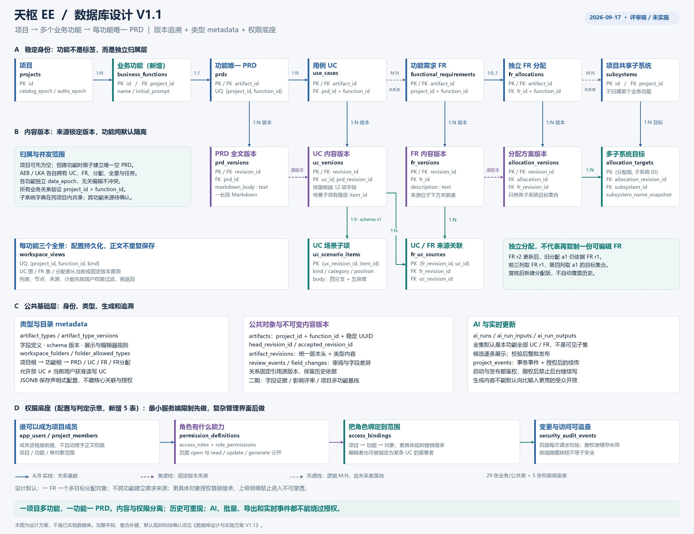
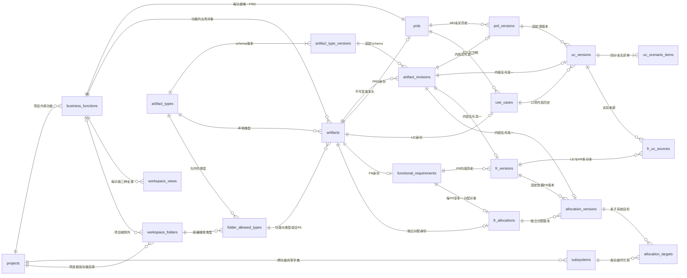
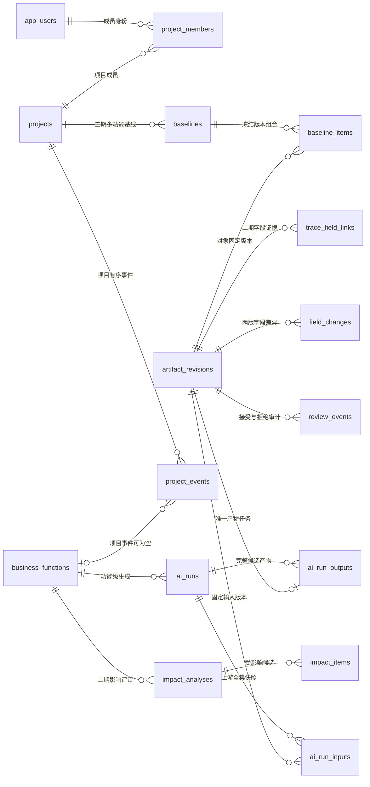
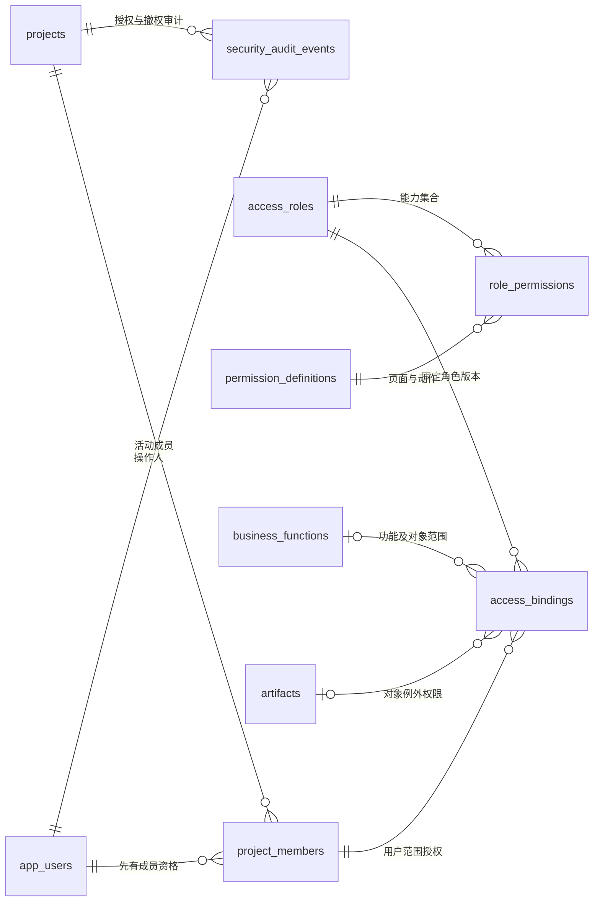

# 天枢 EE 智能开发平台：数据库设计与实施方案 V1.1

> **2026-09-20 子系统专项更新**：每项目独立划分，复杂项目可分内灯/外灯，简单项目可合并。本文件第 6.7 节已同步摘要；字段、版本、权限增补和实施依赖以 [项目级子系统划分与 FR 分配 V1.2](项目级子系统划分与FR分配数据库设计_V1.2.md) 为准。该专项为待确认设计，不是已建表；原关系图尚未包含新增三张方案表，不能单独当作最新建表依据。

> 更新日期：2026-09-17；V1.1 替代 V1.0，旧版“一项目一 PRD”设定已废止。  
> 状态：**设计评审稿，未建库、未执行 SQL、未修改前后端业务代码。**  
> 需求优先级：用户本次明确说明 > 现有前端模型 > 历史实施计划与效果图。  
> 推荐：PostgreSQL 18 + 关系表 + JSONB 类型元数据 + 不可变内容版本。不是把全部业务放进一个 JSON 文档，也不在一期引入图数据库。  
> 阅读顺序：先看第 1～4 节；开发看第 5～12 节；部署看第 13 节；评审与排期看第 14～16 节；**权限选型与底座见第 13.5 节，第 18 节为更新后的数据库图**。

### 本版变更摘要

- **已纠正**：项目 → 多个业务功能 → 每功能唯一 PRD；业务功能不再被降为标签。
- 同步修正：对象/目录/全景/任务/版本来源的 function_id、唯一键、组合 FK、并发 epoch 和接口路径。
- 新增权限建议：页面能力 + 数据范围 + 对象操作；角色配置独立于正文表。建议最小底座随 M1 实现，复杂配置 UI 后续再做。
- 旧版与旧图保存为历史，不应继续按旧的 project_id 单列 PRD 唯一约束实施。
- **本轮没有实施**：数据库、业务接口、Figma、前端交互均未更改。本文的所有未来行为仍是待开发方案。

## 1. 结论：用一句话描述这套设计

**项目是团队与数据隔离边界，业务功能是 PRD → UC → FR → 分配的归属边界；一项目多功能、一功能一 PRD，对象有稳定身份，关系指向不可变版本。权限与正文分离管理。**

业务过程：

```text
项目
  ├─ 功能 A（例如 AEB）
  │    一句话需求 → 唯一 PRD（Markdown）→ 多个 UC → 多个 FR → 独立分配 → 多子系统
  └─ 功能 B（例如 LKA）
       一句话需求 → 唯一 PRD（Markdown）→ 多个 UC → 多个 FR → 独立分配 → 多子系统

UC / FR / 分配全景默认属于各自功能；子系统划分在同项目内共用、跨项目独立；具体方案和分配均引用版本。
“分析全部 UC / FR”默认指当前业务功能内的全部有效对象，不是用户有权限看到的任意子集。
```

### 1.1 对九项要求的落实

| 用户要求 | 本设计的决定 |
|---|---|
| 多项目与各类项目数据 | 一库多项目；业务表、关系表均带 `project_id`，组合外键防止跨项目串联 |
| 一项目多个功能，每功能一份 PRD | `business_functions` 为独立实体；`prds UNIQUE(project_id,function_id)`；每功能一个 PRD 身份、多内容版本，归档不释放唯一性 |
| PRD 是 MD STRING | `prd_versions.markdown_body text` 保存原始全文，不强制拆章节字段 |
| PRD → 多 UC | 每条 UC 归属该功能唯一 PRD，UC 的每个版本记录实际依据的 PRD 版本 |
| UC ↔ FR 多对多 | `fr_uc_sources` 独立关联表，连接 FR 版本与 UC 版本，不使用逗号拼接编号保存关系 |
| FR ↔ 子系统多对多 | FR、FR 分配分表；每个 FR 对应一个分配对象，其每个版本有多个目标子系统 |
| 追溯和修改影响 | 不可变版本 + 版本级依赖 + 字段变更记录；二期增加字段证据与影响评审 |
| 类型和文件夹 metadata | 类型注册表 + JSON Schema + 文件夹允许类型关系；前后端可读，数据库能约束 |
| Ubuntu / 网络访问 / 实施 | PostgreSQL 官方 Ubuntu 包；应用走 HTTPS，数据库走内网或 VPN；分阶段落地 |

### 1.2 已确认与设计默认要区分

以下视为本次已确认：每项目多个功能、每功能一个 PRD、PRD 自由 Markdown、UC 固定结构、两处多对多、FR 与分配独立管理、需要 metadata 与追溯。

2026-09-20 新确认：各项目子系统划分可以不同，Excel 只作参考；不要求每项目固定采用 43 条目录。方案发布与版本生命周期仍是 V1.2 的建议默认。

以下是**设计默认，仍可调整**：

- 项目可先为空；创建一个业务功能时，原子预建该功能的空 PRD 身份及目录，首次生成填入正文而不另建 PRD。
- UC/FR/分配属于一个功能，生成任务与全景按功能隔离。默认不跨功能关联 UC↔FR；若需跨功能共用需求，先评审显式依赖与授权规则（DB-Q11）。
- 权限采用角色能力 + 项目/功能/对象范围；最小底座和接口校验先做，复杂配置界面后做。此处是建议，不是本轮实施授权。
- 一份 FR 对应一个“FR 分配对象”，对象内可选择多个子系统，而不是每勾选一个子系统就新增一个分配标签。
- 生成下游前，全部有效上游必须存在且已接受；有未处理草稿时阻断并列出原因，不暗中漏掉它们。
- 分配页面只修改子系统集合，不在分配页面另改 FR 原文。
- 保存创建版本，接受是独立操作；新版本不会自动改写下游。
- 字段级追溯先做“哪些对象可能受影响”，不承诺仅靠外键自动推断精确字段的语义影响。

## 2. 与现有项目的对照，以及必须修正的旧假设

### 2.1 本次实际核对的文件

- `E:\Git projects\TS-frontend\src\features\uc\model.ts`
- `E:\Git projects\TS-frontend\src\features\fr\model.ts`
- `E:\Git projects\TS-frontend\src\features\workbench\model.ts`
- `E:\Git projects\TS-frontend\src\features\workspace\tree.ts`
- `E:\Git projects\TS-frontend\docs\标签页与左侧导航交互规范.md`
- `E:\Git projects\TS-frontend\docs\design-review\UC与FR分配全景设计说明_2026-09-16.md`
- `E:\Git projects\TS-backend\README.md` 与 `requirements.txt`

当前前端已有 UC 结构化详情、FR 三字段模型和同项目多业务功能 PRD。根据最新代码与实施记录，UC 全景和 FR 分配全景也已接入**本地前端交互**，按业务功能派生并保持项目隔离；还不是数据库持久化。当前分配表读取实时 FR 原文，后续接库需改为读取被分配版本固定引用的 FR 版本。后端已有认证不等于已有业务权限系统；本次不修改认证或后端。

本版追加核对 `src/features/panorama/`、`src/components/panorama/`、`docs/前端页面交互规则.md` 及最新实施记录；不沿用 V1.0 中“全景未接前端”的过时状态。

本设计采用用户本次最新规则，因此：

1. **纠正 V1.0 的缺失层级**：业务功能不是纯分类标签，新增 `business_functions`；同项目 AEB/LKA 可各有一个 PRD。
2. 前端 `featureId` 对应后端 `function_id`；`featureName` 只用于显示，不作外键。
3. 一个对象一个标签仍成立；同项目多功能的 PRD 可并行打开，正文/会话/草稿随对象与功能隔离。
4. 每功能 UC / FR / 分配各一个默认全景。项目级汇总若后续增加，只做受权限过滤的跨功能查询，不另造一套业务正文。
5. 数据库身份和显示编号分开。`FrContent.id` 当前存的是 `Fr-501-01-001`，未来映射为 `code`；不能直接当数据库 UUID。
6. FR `source: string` 未来由关联 UC 的编号渲染，底层必须传 `uc_id` / `uc_revision_id`；编辑来源应用对象选择器，不继续依赖任意文本。
7. 本次不把 Mock 的 13 条 FR、固定项目 A/B 或示例编号当成真实业务限制。

## 3. 数据库选型

### 3.1 推荐 PostgreSQL

建议新库使用 **PostgreSQL 18 的受支持补丁版本**。本次官方版本页列出 18.6；部署当天复核同一主版本的安全补丁，不将版本写成永远不更新的常量。[S1]

本项目的核心不是单纯存长文本，而是保证“一个功能一个 PRD”“多对多”“历史来源不能丢”“并发修改不覆盖”的一致性。采用 PostgreSQL 的关系约束保存核心事实，JSONB 只存有版本的元数据与扩展信息。PostgreSQL 支持 JSONB 及其索引，但 JSONB 自身不等于业务 JSON Schema 校验。[S2][S3]

以下为**面向本项目的架构取舍**，不是数据库产品的性能排名：

| 方案 | 本项目建议 |
|---|---|
| PostgreSQL | 首选，核心业务、版本、关系、任务记录集中管理，避免跨库一致性成本 |
| MySQL | 团队如已有成熟运维可重新评估；目前没有必须换用它的业务理由 |
| MongoDB | 不选作本系统主存储；无需为“PRD 是字符串、metadata 是 JSON”额外引入文档主库 |
| Neo4j 等图数据库 | 不作为一期依赖；先在关系库保留可靠的依赖边，图能力有瓶颈后再评估只读投影 |
| SQLite | 不作为本次 Ubuntu 多人网络部署的目标主库 |
| Redis / 向量库 | 不是当前建模必需品；缓存、向量检索另有明确需求再增加 |

版本关系可先用递归查询遍历；PostgreSQL 提供递归 CTE，足以作为本设计初期追溯实现手段。是否需要图数据库应由实际图规模与查询耗时决定。[S8]

### 3.2 组合方式

- 核心字段、ID、状态、项目归属、来源关系：关系表。
- PRD 全文、UC 文本、FR 描述：`text`，不存成 HTML，不把 Markdown 字符串再 JSON 转义一层。
- 类型定义、显示配置、非关键扩展：`jsonb`，服务端按固定 schema 校验。
- 图片附件若以后需要：对象存储保存二进制，数据库只保存受控引用；一期不主动引入文件上传能力。
- 所有数据放一个 PostgreSQL 数据库的业务 schema（建议 `ee`）；不按项目创建数据库或表。

## 4. 概念说明：对象、版本、视图与 metadata

| 概念 | 例子 | 应不应该单独保存 |
|---|---|---|
| 对象身份 | `FR-001` 是哪条需求 | 保存，UUID 永久稳定 |
| 内容版本 | `FR-001 r3` 的描述是什么 | 保存，不可变 |
| 版本关系 | FR r3 依据 UC-A r2、UC-B r5 | 保存，不能只指向“最新 UC” |
| 分配对象 | 对 FR-001 的子系统分配方案 | 独立保存，有自己的 ID、版本和审阅记录 |
| 分配目标 | 本版选择制动、座舱两个子系统 | 保存为多条目标关系，不是一个逗号字符串 |
| 全景视图 | FR 表、UC 用例图 | 保存视图身份与配置，正文从对象/关系查询 |
| metadata | “UC 有哪些字段”“UC 文件夹只允许 UC” | 保存类型与容器规则，不重复保存业务事实 |
| 标签页 | 用户当前打开 FR-001 | UI 状态；关闭不删除任何业务数据 |

**不要把数据库版本和 PostgreSQL 内部 MVCC 当成一回事。** 这里的 r1/r2/r3 是业务历史，必须显式建表保存。

### 4.1 为什么 FR 分配要独立，而又不直接复制一份 FR

例如：

```text
FR-001（稳定 ID）
 ├─ r1：当前来源 UC-A r2，描述“触发视觉提示”
 └─ r2：描述修改为“触发视觉和声音提示”

ALLOC-001（另一个稳定 ID，归属 FR-001）
 ├─ a1：依据 FR-001 r1 → 子系统 A
 └─ a2：依据 FR-001 r1 → 子系统 A、B
```

FR 发布 r2 后，a2 **仍明确依据 FR r1**，被标记为“上游已有变化，待检查”。用户确认后再创建 a3，绑定 FR r2。a1/a2 的历史不能被修改。

FR 分配表的前三列通过 `allocation_versions.fr_revision_id` 读取**被引用版本**的编号、来源、描述；第四列从 `allocation_targets` 聚合名称。这样满足 FR / 分配独立存储，又不会有两份可随意修改而互相冲突的 FR 原文。

如果将来允许子系统级需求细化，可在分配对象下另建“分解需求”类型，而不是让当前相同的描述字段悄悄变成另一种语义。

## 5. 表总览与统一约定

### 5.1 建议表清单

> 下方 34/39 张是 V1.1 原基线。V1.2 子系统专项新增 `project_subsystem_designs`、`subsystem_design_versions`、`subsystem_version_items` 三张核心表，修改现有 `subsystems` 与分配版本/目标；其他范围不变时，一期为 37、含二期为 42。可选模板/域/拆并映射/M-xxx 表尚不计入，均不是已执行迁移。

为避免一张万能 JSON 表，也避免每种类型复制整套版本系统，采用“公共对象层 + 四类业务子表”。纠正层级后有 **29 张业务/公共目标表**（原 28 张 + business_functions）；建议再增加 **5 张权限底座表**，合计 **34 张一期目标表**，分里程碑上线。另有 5 张二期追溯增强表，共 39 张目标表。权限表不替代业务表，数量不是本轮建表或开发承诺。

| 组别 | 表 | 数量 | 职责 |
|---|---|---:|---|
| 项目、功能与用户 | `app_users`, `projects`, `business_functions`, `project_members` | 4 | 身份映射、项目/业务功能归属、成员关系 |
| 权限底座（推荐纳入 M1） | `permission_definitions`, `access_roles`, `role_permissions`, `access_bindings`, `security_audit_events` | 5 | 能力点、角色、范围授权与审计；详细字段见 13.5 |
| 类型与容器 | `artifact_types`, `artifact_type_versions`, `workspace_folders`, `folder_allowed_types` | 4 | metadata、schema、目录约束 |
| 公共对象与版本 | `artifacts`, `artifact_revisions` | 2 | 稳定身份与历史版本头 |
| PRD | `prds`, `prd_versions` | 2 | 每功能唯一 PRD 与全文 |
| UC | `use_cases`, `uc_versions`, `uc_scenario_items` | 3 | 用例与嵌套场景 |
| FR | `functional_requirements`, `fr_versions`, `fr_uc_sources` | 3 | 需求与多对多来源 |
| 分配 | `subsystems`, `fr_allocations`, `allocation_versions`, `allocation_targets` | 4 | 子系统及独立分配方案 |
| 全景 | `workspace_views` | 1 | 视图配置，不复制正文 |
| 生成过程 | `ai_runs`, `ai_run_inputs`, `ai_run_outputs`, `project_events` | 4 | 快照、幂等、增量更新 |
| 审阅与变更 | `review_events`, `field_changes` | 2 | 接受/拒绝审计、字段 diff |
| 二期增强 | `trace_field_links`, `impact_analyses`, `impact_items`, `baselines`, `baseline_items` | 5 | 字段证据、影响评审、基线 |

`v_fr_current`、`v_uc_current`、`v_allocation_current`、`v_lineage_edges` 是可选 SQL VIEW / 查询层名称，**不是上述额外业务表**。

### 5.2 字段与命名约定

- `id uuid`：应用生成的主键；业务编号单独 `code text`，不依赖会变更的名称。
- `project_id uuid NOT NULL`：项目数据、关系、任务与事件的隔离键。
- `function_id uuid NOT NULL`：四类业务对象及其版本/场景/来源/分配关系、视图、AI 任务、审阅、字段变更的功能归属键；复合 FK 验证归属。项目级根目录、字典、成员/权限、事件和二期项目基线有明确例外，见 6.1。
- 时间采用 `timestamptz`，按 UTC 写入，前端按用户时区显示。
- `created_at`、`created_by`：创建时间与操作用户；系统生成由发起用户 + 任务 ID 共同解释。
- 身份表带 `updated_at`、`archived_at NULL`；版本与来源关系不物理覆盖。归档不是删除历史。
- `metadata jsonb NOT NULL DEFAULT '{}'`：仅用于约定的扩展；不能把关联 ID、权限或业务状态藏进去。
- 文本默认 `NOT NULL`；草稿允许空字符串的字段，由接受校验进一步收紧。`N/A` 保留原文，不强制转成 NULL。
- 枚举在 schema / Pydantic 和 DB CHECK 中统一，如 `PRD`, `UC`, `FR`, `FR_ALLOCATION`；界面名称仍是“FR分配”。
- `created_via`：`manual / ai / migration`；`ai_run_id NULL` 只在 AI 来源版本上存在。
- 本文 `PK` 为主键，`FK` 为外键，`UQ` 为唯一约束；子表下文省略的通用字段以本节为准。
- `source / subsystemNames` 等显示字段可由查询返回，但不能因此省去真实外键关系。

## 6. 核心表：字段与关系

### 6.1 用户、项目与业务功能

#### `app_users`：业务操作人的稳定身份

| 字段 | 类型/约束 | 含义 |
|---|---|---|
| id | uuid PK | 操作人身份 |
| auth_subject | text UQ NOT NULL | 当前认证系统映射标识，不存 Cookie / JWT |
| display_name | text NOT NULL | 展示名称 |
| disabled_at | timestamptz NULL | 禁用时间；历史署名仍可读 |
| created_at | timestamptz | 建立时间 |

一期先映射既有登录用户，不要求因此重做注册、改密或 SSO。用户注销不级联删除需求历史。

#### `projects`

| 字段 | 类型/约束 | 含义 |
|---|---|---|
| id | uuid PK | 项目 ID |
| code | text UQ | 项目编号，不局限 A/B |
| name, description | text | 名称和说明 |
| state | text CHECK | active / archived |
| data_epoch | bigint，初始 0 | 项目汇总缓存的变化序号，不用作所有功能任务统一冲突门槛 |
| catalog_epoch | bigint，初始 0 | 本项目正式子系统划分发布变更序号，分配任务冻结并校验；仅存草稿不递增（V1.2） |
| authz_epoch | bigint，初始 0 | 项目成员/范围授权变更序号，使旧权限缓存失效 |
| event_sequence | bigint，初始 0 | 项目事件的持久递增计数，清理旧事件后也不重置 |
| metadata | jsonb | 非关键项目扩展 |
| created_by, created_at, updated_at, archived_at | 通用 | 创建与归档 |

项目 data_epoch 用于汇总失效；功能 data_epoch 才用于功能生成并发校验。子系统新正式方案发布时递增 catalog_epoch；仅保存方案草稿不递增（V1.2）；成员/授权变更递增 authz_epoch。阅读、图布局、逐字 token 不改变内容 epoch。共享字典变化影响各功能分配任务，但 AEB 正常编辑不应令 LKA 的无关 UC 任务失败。

#### `project_members`

`(project_id, user_id) PK/FK`，`state CHECK(active/disabled)`、`created_at`。这里只保存成员资格，**不再与权限表并存第二套可编辑 role 字段**；角色与范围统一从 access_bindings 读取。现有界面需要显示成员角色时返回只读投影。

成员资格本身不授予内容阅读/编辑权；默认拒绝，创建项目时同时给创建人写入项目管理员绑定。项目至少保留一个有效管理员的规则需受控事务校验。

#### `business_functions`：项目内的业务功能（新增）

| 字段 | 类型/约束 | 含义 |
|---|---|---|
| id | uuid PK | 稳定功能身份，前端 featureId 的后端对应值 |
| project_id | uuid FK | 归属项目 |
| code | text；UQ(project_id,code) | 功能编号，创建后稳定，归档不复用 |
| name, description | text | 如 AEB、LKA；名称不是关联键 |
| initial_prompt | text | 此功能的一句话需求；每次 AI 实际输入仍入 ai_runs |
| state / archived_at | active/archived / timestamptz NULL | 活动/归档状态必须一致 |
| data_epoch | bigint，初始 0 | 此功能上游集合、工作/接受版本的变化序号 |
| metadata | jsonb | 标签等非关键扩展 |
| created_by, created_at, updated_at | 通用 | 审计字段 |

UQ `(project_id,id)` 供所有功能级组合 FK 引用；`project_id` 建立后不可变。创建项目可有 0 个功能；创建功能的事务必须建立其唯一 PRD 身份与系统目录。界面若选择“创建项目并创建第一个功能”，可把两个步骤包在同一事务，但不是“项目本身拥有一份 PRD”。

归档功能不释放 PRD 唯一性，不物理删除 UC/FR/分配；默认整条链不再参与活动全景/新生成。恢复仍使用同一身份。不同功能可以同时生成，功能内仍遵守输入接受与冲突规则。

**归属范围矩阵（用于避免漏加/滥加 function_id）：**

| 范围 | 表/对象 | 规则 |
|---|---|---|
| 全局 | app_users、类型 metadata、权限定义/角色/角色能力 | 不强行填 project_id；默认定义不是授权 |
| 项目 | projects、project_members、subsystems、权限审计、二期 baselines | 同项目共用；项目基线可包含多个功能 |
| 功能 | artifacts、四类业务身份/版本、artifact_revisions、uc_scenario_items、fr_uc_sources、allocation_targets、workspace_views、ai_runs/inputs/outputs、review_events、field_changes | project_id + function_id 非空，组合外键禁止串功能 |
| 容器 | workspace_folders | 项目根的 function_id 为 NULL；功能根和其子目录为固定非空 function_id |
| 类型放置规则 | folder_allowed_types | 只为功能内对象容器建规则，function_id 非空 |
| 事件/授权 | project_events、access_bindings | 按 scope 决定 function_id 是否为空，必须有 CHECK 和具体 FK |
| 二期影响分析 | impact_analyses、impact_items、trace_field_links | 发起功能/受影响功能显式记录；本版只接受同功能业务依赖 |

### 6.2 类型 metadata 和文件夹

#### `artifact_types`

`code text PK`（固定四种），`display_name text`，`description text`，`enabled boolean`。

只有类型注册，不允许用户随意上传代码就扩展可执行类型。

#### `artifact_type_versions`

| 字段 | 类型/约束 | 含义 |
|---|---|---|
| id | uuid PK | schema 版本 ID |
| type_code | text FK | UC / FR 等 |
| version | integer > 0，UQ(type_code, version) | 类型结构版本，不是业务内容 r 版本 |
| content_schema | jsonb | JSON Schema：API 内容结构校验 |
| field_catalog | jsonb | 稳定字段键、中文名、类型与 canonical path |
| ui_schema | jsonb | 展示顺序、编辑器类型、只读字段 |
| extra_metadata_schema | jsonb | 限定实例 metadata 可填什么 |
| created_at, created_by | 通用 | 定义发布信息 |

已发布定义不可原地改；字段升级创建 v2，旧内容继续绑定 v1；v2 的新必填字段不应使旧版本突然失效。真正的物理列变更仍要数据库迁移，不会“改 JSON 自动建表”。

#### `workspace_folders`

`id uuid PK`、`project_id FK`、`function_id uuid NULL FK`、`parent_id uuid NULL`、`name text`、`role text`（project_root/function_root/prd/uc/fr/fr_allocation/group）、`sort_order integer`、`metadata jsonb`、通用审计字段。

默认目录为：项目根 → 功能根（如 AEB）→ PRD / UC / FR / FR分配；分类角色是固定 code，中文名可变。默认不开放任意移动这些系统目录。父子必须同项目；功能根只能挂到项目根，其他功能内目录只能挂到同功能父目录，不能 AEB 目录挂到 LKA 下。项目根 function_id 必须为空，功能根及其后代非空。禁止把自己及后代设为父目录；规则需事务/触发器，不能仅靠父 ID 外键。

#### `folder_allowed_types`

`(project_id, function_id, folder_id, type_code) PK`，分别 FK 到同项目同功能文件夹和类型注册表。

例：UC 文件夹只有一行 `UC`；FR 文件夹只有 `FR`。`artifacts(project_id, function_id, folder_id, type_code)` 直接 FK 到这个组合，所以即使跳过前端也不能把 FR 插进 UC 文件夹。

文件夹规则是唯一真源；返回给前端的 `allowedTypes: ["UC"]` 由此表生成，**不在 metadata 内再维护第二份规则**。一旦存有对象，不可直接删除对应允许类型；迁移规则需要显式迁移已有对象。

### 6.3 公共对象身份与版本头

#### `artifacts`

| 字段 | 类型/约束 | 含义 |
|---|---|---|
| id | uuid PK | PRD / UC / FR / 分配的统一对象 ID |
| project_id | uuid FK | 项目归属 |
| function_id | uuid NOT NULL，同项目 FK | 业务功能归属，建立后不可原地跨功能移动 |
| type_code | text FK | 四类业务对象之一；身份建立后不可改类型 |
| folder_id | uuid FK（组合） | 受类型限制的存放目录 |
| code | text；UQ(project_id, function_id, type_code, code) | 稳定显示编号，创建后不可改、归档不重用 |
| head_revision_id | uuid NULL FK（同对象） | 最新已发布工作版本，尚未生成时 NULL |
| accepted_revision_id | uuid NULL FK（同对象） | 最近接受版本；新草稿不擦除它 |
| lock_version | bigint | 编辑/审阅 CAS 乐观锁 |
| metadata | jsonb | 可选分类、标签等；不藏核心关联 |
| created_at, created_by, updated_at, archived_at | 通用 | 审计与软归档 |

编号默认按功能内同类型唯一，允许 AEB/LKA 各有 UC-001；项目汇总须显示功能名/编号，所有写入与来源关系使用 UUID 而非裸 code。编号沿用现有前端的只读规则；若未来开放重编号，需要另加版本编号快照/别名映射，不能直接改 code 导致历史展示一起变化。

`title` 不复制到 artifacts 作独立可编辑字段：UC 名称读其内容版本；PRD 标题可从 MD 显示提取，FR 标签可用编号 + 摘要。需要列表缓存时必须明确是可重建缓存。

#### `artifact_revisions`

| 字段 | 类型/约束 | 含义 |
|---|---|---|
| id | uuid PK | 内容版本 UUID |
| project_id, function_id, artifact_id, type_code | 组合 FK | 归属与类型，防止串项目/功能/类型 |
| revision_no | bigint > 0；UQ(artifact_id, revision_no) | r1/r2/r3，仅对该对象递增 |
| base_revision_id | uuid NULL FK（同对象） | 从哪一版修改来；首版 NULL |
| type_version_id | uuid FK（匹配 type_code） | 内容遵循哪个类型 schema |
| content_hash | text | 对规范化内容及关键关系的摘要；不是加密或鉴权 |
| created_via | text CHECK | manual / ai / migration |
| ai_run_id | uuid NULL FK（同项目） | AI 生成来源 |
| change_summary | text | 本次修改说明 |
| extra_metadata | jsonb | 本版本扩展信息快照 |
| created_by, created_at | 通用 | 谁何时创建 |

只保存版本头，不放第二份整套 UC / FR 可编辑 JSON。具体内容在对应子表；一次事务必须写齐版本头、类型子表、嵌套项、来源关系。已完成版本不 UPDATE / DELETE；运行账号无直接修改历史权限。

### 6.4 PRD：唯一对象与 Markdown 全文

#### `prds`

`artifact_id uuid PK/FK(PRD artifacts)`、`project_id uuid NOT NULL`、`function_id uuid NOT NULL`；FK `(project_id,function_id) → business_functions(project_id,id)`；UQ `(project_id,function_id)`。project_id 单列不再唯一，允许同项目多个功能各有 PRD。

创建业务功能的事务同时建立 PRD artifact 和 prds 行；无正文时两个版本指针均 NULL。唯一约束只保证“每功能最多一份”，**“每功能必须有一份”由功能创建原子事务 + 延迟完整性检查保证**。项目允许没有功能，但任何已提交功能不能缺 PRD 身份。

#### `prd_versions`

`revision_id uuid PK/FK(PRD artifact_revisions)`，`project_id, function_id, prd_id` 组合关联身份，`markdown_body text NOT NULL`。

用户保存 MD 时保存原文；不强制固定标题、字段或卡片数。`metadata`、版本号、作者是系统属性，不是给 PRD 正文划字段。渲染时限制原始 HTML/脚本，避免存储文本导致 XSS。

### 6.5 UC：对齐前端 12 个字段

#### `use_cases`

`artifact_id uuid PK/FK(UC artifacts)`、`project_id, function_id`、`prd_id uuid FK(同项目同功能 prds)`。

一份 PRD 下可有任意多条 UC；不能将 UC 挂到别的项目或别的功能 PRD。

#### `uc_versions`

| 前端字段 / 业务字段 | 数据库存储 | 说明 |
|---|---|---|
| 系统版本 | revision_id PK，project_id，function_id，uc_id | 关联 UC 版本头 |
| 来源 PRD 版本 | prd_revision_id uuid FK | **该版 UC 真正依据的 PRD 版**，且必须属于 use_cases.prd_id |
| 用例名称 `name` | name text | 原文 |
| 用例描述 `description` | description text | 原文 |
| 用例编号 `number` | artifacts.code | 稳定编号，不额外在 UC 版本内写一份 |
| 参与者 `actors` | actors_text text | 保留当前前端自由文本 |
| 前置条件 `preconditions` | preconditions text | 保留换行与表达式 |
| 场景 `mainFlow` | main_flow text | 主事件流 |
| 场景 `branches` | uc_scenario_items(kind=branch) | 当前 4 个分支，排序返回 |
| 场景 `exceptions` | uc_scenario_items(kind=exception) | 当前 5 种异常，排序返回 |
| 后置条件 `postconditions` | postconditions text | 原文 |
| 扩展用例 `extensions` | extensions_text text | 当前保留文本；确有关系后再结构化 |
| HMI 交互逻辑 `hmi` | hmi_logic text | 原文 |
| 法规需求 `regulations` | regulations text | 保存用户/AI 原文，不视为已核实法规结论 |
| 性能需求 `performance` | performance text | 不把示例阈值当事实 |
| 非功能需求 `nonfunctional` | nonfunctional text | 原文 |

主流程、分支、异常合起来是**一个“场景”顶层字段**，因此界面仍是 12 项，不是新增了若干业务字段。

#### `uc_scenario_items`

| 字段 | 类型/约束 | 含义 |
|---|---|---|
| project_id, function_id, uc_id, uc_revision_id | 组合 FK | 归属 UC 的某版本 |
| item_id | uuid | 场景项稳定 ID，修改/重排复用，新增才创建 |
| kind | text CHECK | branch / exception |
| category | text | 分支槽位 a1～a4；异常五个固定 code |
| position | integer ≥ 0 | 版本内显示次序，不作为身份 |
| body | text | 场景原文 |

PK `(uc_revision_id, item_id)`；UQ `(uc_revision_id, kind, category)`、`(uc_revision_id, kind, position)`。

异常类别固定映射：`vehicle_state / mechanical / environmental / misuse / power`，对应车辆状态异常、机械故障、环境突变、用户误操作（滥用）、供电异常。

当前 schema v1 要求 4 个 branch、5 个 exception，包括 `N/A` 行；未来可用 schema v2 放宽分支数，数据库不建 branch_1～branch_20 列。场景项数量是跨行规则，须在发布/接受事务完整性校验中验证，不能用普通行级 CHECK 冒充完成。[S3]

接口兼容层可把场景项投影回当前 `string[4]` / `string[5]`。为了字段追溯，新 API 同时返回 item_id，不能用数组下标当跨版本标识。

### 6.6 FR：内容与多对多来源

#### `functional_requirements`

`artifact_id uuid PK/FK(FR artifacts)`、`project_id, function_id`。没有单一 `uc_id`，因为同一 FR 可以来自多个 UC。

#### `fr_versions`

`revision_id uuid PK/FK(FR artifact_revisions)`、`project_id, function_id, fr_id` 组合归属，`description text NOT NULL`。

FR 页面三字段对应：

- 需求编号：`artifacts.code`。
- 需求来源：`fr_uc_sources` 关联的 UC 编号集合，API 返回结构化 sources 后再渲染。
- 需求描述：`fr_versions.description`。

#### `fr_uc_sources`

`project_id, function_id`、`fr_revision_id FK`、`uc_id FK`、`uc_revision_id FK`、`rationale text`（为什么关联）、`created_via`。

PK `(fr_revision_id, uc_id)`；同一 FR 版本对同一 UC 只引用一个版本；组合外键验证 uc_revision_id 确属于该 uc_id 和同项目同功能。

示例：

| FR 版本 | UC 身份 | 实际引用的 UC 版本 |
|---|---|---|
| FR-001 r1 | UC-001 | r2 |
| FR-001 r1 | UC-002 | r4 |
| FR-002 r1 | UC-002 | r4 |

既表达 UC↔FR 多对多，也保留来源历史。删除 FR-001 r2 的某个来源时创建新版本对应的新集合，不删除 r1 来源记录。

**任务读取了全部 UC，不表示每条生成 FR 都来源于全部 UC。** `ai_run_inputs` 保存分析输入全集；`fr_uc_sources` 保存逐 FR 的实际依据子集，两者不可混用。

草稿允许暂缺来源，但标为不完整；接受必须至少一个有效来源，除非后续明确允许无 UC 的独立 FR。跨项目来源始终禁止；跨功能来源在本版默认不开放，需按 DB-Q11 单独扩展，不通过遗漏 function_id 检查来实现。

### 6.7 子系统划分与 FR 分配（2026-09-20 按 V1.2 专项更新）

最新明确要求是**各项目自行划分子系统**，而非统一固定目录。字段、约束和完整例子见 [V1.2 专项设计](项目级子系统划分与FR分配数据库设计_V1.2.md)。以下为摘要，新增流程尚未实施。

#### 项目子系统方案

- `project_subsystem_designs`：project_id PK/FK，working_version_id、published_version_id、lock_version。建议一项目一个方案入口、一个当前正式版；多个并行系统/方案待确认。
- `subsystem_design_versions`：id、project_id、version_no、parent_version_id、base_published_version_id、来源/署名/发布留痕。保存产生不可变完整快照。
- `subsystems`：id、project_id、稳定 code、创建审计；UQ(project_id,code) 和 UQ(project_id,id)。身份不随改名变化。
- `subsystem_version_items`：project_id、design_version_id、subsystem_id、本版 name/description/职责边界/域分组/is_allocatable/顺序/来源。复合主键及两组同项目 FK 防止串项目。

名称、职责、可分配状态放在版本条目里，替代旧的 `subsystems` 当前正文及整数 catalog_version。已引用身份和旧版条目不能物理删除。真正拆分/合并使用新身份与新方案，保留原分配；具体维护人与发布权限见 V1.2，不直接沿用“所有用户永远不能维护”的旧假设。

#### `fr_allocations`

保持独立分配对象：artifact_id、project_id、function_id、fr_id，同项目同功能 FK；UQ(project_id,function_id,fr_id)。一个 FR 可以有一个分配身份和多个历史分配版本，不因选择多个子系统而新建多个标签。

#### `allocation_versions`

保留 revision_id、project_id、function_id、allocation_id、fr_id、fr_revision_id、note，增加 **design_version_id**，固定引用本项目的某个方案版本。FR 版本归属约束仍保留。

#### `allocation_targets`

保留 project_id、function_id、allocation_revision_id、subsystem_id、rationale，增加 **design_version_id**。

- `(project_id,function_id,allocation_revision_id,design_version_id)` FK 到分配版本对应组合键，保证同一分配不混方案。
- `(project_id,design_version_id,subsystem_id)` FK 到方案条目复合主键，保证目标属于该项目该方案。
- PK(allocation_revision_id,subsystem_id) 防止重复；状态与当前发布版本由受控保存/接受事务校验。
- 名称从所引用的版本条目读取，不连接当前名称；原 `subsystem_name_snapshot` 可省略，若兼容保留则只从固定条目生成、不可独立修改。
- 修改目标集合写新分配版本；清空仍按原建议保存待处理、不可接受，合法“不适用”规则另确认。
- 新方案发布不自动迁移 FR，旧分配保留并提示依据旧方案、待复核；需重新接受才形成新版本。
- FR 原文仍只在 FR 对象编辑。跨项目的相同名称/编号不形成关系。

### 6.8 全景视图配置

#### `workspace_views`

`id uuid PK`、`project_id, function_id`、`kind CHECK(UC_OVERVIEW/FR_OVERVIEW/ALLOCATION_OVERVIEW)`、`name text`、`renderer_key text`、`renderer_version integer`、`settings jsonb`、`lock_version bigint`、`created_at, updated_at`，UQ `(project_id, function_id, kind)`。

每个功能三种默认全景，查询必须同时按 function_id 和用户权限过滤。只存列表列顺序、筛选条件、图布局策略等；不存一份可独立编辑的 rows/body。返回的 UC 节点、FR 行、分配目标来自业务表和指定版本模式，源数据一改视图自然变化。

UC 用例图：节点 ID 用 UC 对象 UUID，标签来自当前 UC name；参与者原文可在节点说明显示。**自由文本 actors/扩展用例不等于结构化 UML 关系**；若要自动画多角色连线、include/extend，需要定义经过校验的角色/关联投影，不能随便按逗号分割或让布局引擎猜测。一期先提供用例节点与可确定的角色投影；不确定的关系只显示文本提示，详细角色关系模型列入待确认项。

图布局坐标若保存，节点引用用 UUID，配置带 `source_epoch`；过期坐标可丢弃重算。它不是 UC 内容的另一来源。本轮既有“图节点不可编辑、无 UC–FR 连线”限制仍保留。

## 7. AI 生成任务、输入快照与实时更新

### 7.1 任务表

#### `ai_runs`

| 字段 | 类型/约束 | 作用 |
|---|---|---|
| id | uuid PK | 任务标识 |
| project_id | uuid FK | 项目隔离 |
| function_id | uuid NOT NULL，同项目 FK | 本次生成所属功能，不接受仅凭功能名称指定目标 |
| stage | text CHECK | PRD / UC / FR / FR_ALLOCATION |
| status | text CHECK | queued / running / ready / succeeded / failed / cancelled / conflict |
| operation | text CHECK | generate / revise / analyze；检查任务可无产物 |
| target_artifact_id | uuid NULL，同项目同功能 FK | 单对象修改目标；批量生成为空 |
| prompt_text | text | 用户本次实际输入 |
| prompt_template_version, model_id | text | 模板和模型配置记录，不在这里保存 API Key |
| parameters | jsonb | 温度等非敏感参数、算法版本 |
| subsystem_design_version_id | uuid NULL，同项目 FK | V1.2 增补：FR_ALLOCATION 任务必须固定方案版本，其他阶段为空；不冒充 artifact 输入 |
| catalog_snapshot | jsonb | 选定方案的输入证据副本，由不可变版本条目生成；不能替代正式 FK |
| base_function_epoch | bigint | 冻结输入时本功能 data_epoch |
| base_catalog_epoch | bigint NULL | 分配任务冻结的项目子系统字典版本；其他阶段可为空 |
| requested_authz_epoch | bigint | 启动时的权限版本，用于失效检测；不替代发布时重新鉴权 |
| input_set_hash | text | 排序后的全部输入对象 ID/版本 ID 及阶段策略摘要 |
| idempotency_key | text；UQ(project_id, function_id, idempotency_key) | 同一次请求重试不会重复创建 |
| retry_of_run_id | uuid NULL，同项目同功能 FK | 真正重新执行另建任务，保留失败来源 |
| lease_owner, lease_expires_at, attempt_no | text / timestamptz / integer | worker 租约，宕机恢复与接管 |
| progress, error_code, error_detail | 数值 / text | 进度和可读失败原因 |
| requested_by, created_at, started_at, finished_at | 通用 | 操作人和生命周期 |

不在数据库事务里等待模型响应；输入读取完成后关闭事务，AI 在事务外执行。

#### `ai_run_inputs`

`project_id, function_id`、`run_id FK`、`artifact_id FK`、`revision_id FK`、`role CHECK(primary/context)`，PK `(run_id, artifact_id)`。版本必须属于对应对象、项目和功能。

- 首次生成 PRD：允许没有 primary artifact 输入，以该功能 initial_prompt/本次 prompt_text 为依据；修订 PRD 冻结目标旧版本及显式参考，不套用“必须先有接受版 PRD”的循环门槛。
- 生成 UC：一行当前功能 PRD 的接受版本。
- 生成 FR：当前功能全部有效 UC，每个对象恰好一个接受版本。
- 生成分配：当前功能全部有效 FR，每个对象恰好一个接受版本；固定 subsystem_design_version_id，并从该方案生成 catalog_snapshot（V1.2）。
- 额外参考的业务对象标为 context，不自动变成实际业务来源。附件不是本期四类 artifact，未来另加附件表和任务附件关联，不能把附件 ID 写入 artifact_id 外键。

来源校验要求：生成 UC 的 prd_revision_id 必须属于任务 primary 输入；生成 FR 的每条 fr_uc_sources 必须引用冻结的 primary UC 版本；生成分配的 fr_revision_id 同理，目标必须属于 catalog_snapshot 且发布/接受时仍可用。不能只校验 UUID 存在就接受模型虚构的来源。

集合冻结按项目 → 功能 → 对象的统一顺序短时加锁，再读取身份、归档状态和版本指针；所有发布与权限变更遵守同一锁协议，得到一致输入集合。不在长时间 AI 调用期间持锁。对 UC/FR/分配阶段，输入集合为空、缺接受版本或存在较新未接受版本时，不调用 AI，返回明确阻断清单。设计默认还检查上游对象自身的来源是否过期：有已知未处理的上游变更时不能仅凭“已接受”放行，先复核并生成绑定新来源的接受版本；是否允许显式豁免并保留评审证据，随 DB-Q01/Q04 确认。

#### `ai_run_outputs`

`project_id, function_id`、`run_id FK`、`output_key text`（流中的稳定产物键）、`artifact_id`、`revision_id`、`base_revision_id NULL`、`operation CHECK(create/revise)`、`state CHECK(staged/published/rejected)`、`created_at`。

PK `(run_id, output_key)`；UQ `(run_id, artifact_id)`、`UQ(revision_id)`；一个任务对同对象至多一个最终候选版本，一个候选版本只归属一次生成任务。所有版本 FK 校验对象与类型归属；还须校验对应 artifact_revisions.ai_run_id 等于当前 run_id。

**现有对象版本沿用原 artifact_id。** 新对象先预留 UUID，只有明确新增才创建。不能用编号/名称模糊匹配来覆盖现有对象；AI 未输出的旧对象也不能默认删除。

#### `project_events`

`project_id`、`function_id uuid NULL`、`sequence bigint`、`event_id uuid UQ`、`event_type text`、`artifact_id NULL`、`revision_id NULL`、`run_id NULL`、`data_epoch bigint`（项目汇总）、`function_data_epoch bigint NULL`、`authz_epoch bigint`、`payload jsonb`、`created_at`、`dispatched_at NULL`，PK `(project_id, sequence)`。

功能对象事件的 function_id 必填，项目/成员/共享字典事件可为空；任何 artifact_id/revision_id/run_id 都必须与事件的项目及功能匹配。项目 sequence 在持有项目行锁的短事务内通过 projects.event_sequence 递增分配，用于提交后的事件顺序与断线续传；不直接拿全局 UUID 或裸 sequence 分配时间冒充提交顺序。事件只放通知必要信息，客户端按 ID 查询授权数据，不在公开事件里广播整份需求。

**作为事务 outbox 使用**：业务落库和通知事件同事务；提交后 worker 投递 SSE/WebSocket。投递至少一次，客户端按 event_id/sequence 去重；旧事件过期时返回“需要全量同步”，不能返回不完整历史却声称已同步。

### 7.2 “实时更新”怎么做到又不污染正式数据

建议把“流式候选预览”和“已发布工作版本”区分，避免一半 JSON 成为真实 UC：

1. token 到达时只展示聊天生成进度；不每个 token 创建一个需求版本。
2. 一条完整 UC / FR / 分配产物到达并通过结构校验后，写入**不可变候选版本**、必要关系和 ai_run_outputs(staged)，发 `candidate_ready` 事件。
3. 全景接口在“生成中预览”模式读取：已发布 head + 当前任务 staged 候选覆盖层。候选按 output_key/对象 ID 去重，UC 图增量加节点，FR 表增量加行。
4. 页面明确显示“生成中 / 候选”，候选不能接受或用于下一阶段，也不改变其他已打开对象的正式 head。
5. 整批结束后，在短事务中验证来源集合、功能 base_function_epoch（分配再验 base_catalog_epoch）、各输出 base_revision_id、类型和所有关系。合法则原子更新各 head 指针、输出 state，增加功能和项目汇总 data_epoch，写发布事件。
6. 发布后对象为待接受，用户仍可手动编辑；不会自动推进下一阶段。
7. 失败/取消：保留候选供任务回看，但从默认全景去掉覆盖层；正式 head 不变。不把“生成了 6/13 条”伪装为成功的全集。
8. 后续若产品希望“部分结果也可接受”，应设计显式部分提交操作；不把当前默认静默改成半批提交。

这仍满足实时看到 UC 图 / FR 表 / 分配结果，不等于每个半成品都成为下游依据。生成中的候选身份可出现在任务预览区；普通工作空间目录默认只列有 published head 的对象，避免异常中断留下幽灵对象。

### 7.3 重新生成与编辑的并发

- 用户编辑提交 `expected_head_revision_id + lock_version`，数据库在事务内比较；不一致返回 409，保留用户文本供比较。
- AI 任务在 UC r2 上开始，执行中用户保存 r3：旧任务结果进入 conflict，不覆盖 r3，也不抢切当前标签。
- 即使每个旧输入版本都仍在，期间新增/归档了 UC 也意味着“全部 UC”集合变化。必须比较 base_function_epoch / input_set_hash（分配另验 base_catalog_epoch），而不只检查旧输入是否删除。
- 同项目同功能同一阶段初期仅允许一个活跃生成任务，用 `(project_id, function_id, stage)` 的部分唯一索引限制 queued/running/ready；不同功能可并行；同功能跨阶段并发由最终功能 epoch 检测保护。
- worker 租约过期后可恢复任务，但一次正式 publish 要通过 CAS 和幂等校验；先获得新的有效租约再提交。
- 版本号在持有该 artifact 行锁时分配，或以唯一约束冲突重试；不能裸用 `MAX(revision_no)+1`。
- 一次批量发布按固定顺序锁项目和对象，失败整体回滚；大批处理的性能和事务时长在验收数据规模下实测。

## 8. 保存、接受、归档与追溯

### 8.1 审阅状态不能混进正文

#### `review_events`

`id uuid PK`、`project_id, function_id`、`artifact_id`、`revision_id`、`sequence bigint`、`decision CHECK(accept/reject/withdraw)`、`actor_id`、`reason text`、`created_at`；UQ `(revision_id, sequence)`，所有操作 append-only。

- 新生成/保存后无 accept 事件：待处理。
- 接受：校验所审版本仍为 head、必填项和上游条件通过，原子追加 accept 事件、更新 accepted_revision_id、增加 data_epoch。
- 编辑已接受内容：允许创建新工作版本；accepted_revision_id 保留旧接受版，head 指向新草稿；下游因存在待处理变化而阻断。
- 拒绝当前草稿：记录 reject/withdraw 事件，head 可回退最近有效接受版；无接受版的对象归档或恢复空状态；不删除版本。
- 普通“取消编辑 / 不保存并关闭”不建新版本，不是 reject 对象。关闭标签是 UI 行为，不调用删除 API；功能/对象是否可读写仍需当前权限校验。
- 是否允许撤销一个已被下游使用的接受决定需产品确认。默认不能使历史消失，只记录撤销及影响检查。

**状态拆开表达**：`content_review_state`（待处理/已接受）、`archived_at`（是否有效）、`has_newer_upstream`（来源已变化）、`impact_state`（影响评审结果）不是同一个 status 枚举。

### 8.2 字段变更记录

#### `field_changes`

`id uuid PK`、`project_id, function_id`、`artifact_id`、`from_revision_id NULL`、`to_revision_id`、`field_key text`、`item_id uuid NULL`、`change_kind CHECK(add/remove/replace/reorder)`、`before_value jsonb`、`after_value jsonb`、`created_at`。

`from_revision_id/to_revision_id` 必须同项目同功能、同 artifact_id；from 非空时须为较早版本。field_key 按相应旧/新 type_version 校验；新增字段校验新版、移除字段校验旧版，场景 item_id 也必须属于相应版本。

`field_key` 来源于类型 field_catalog，不是任意拼接的中文显示名。例如：

- `uc.name`
- `uc.scenario.mainFlow`
- `uc.scenario.branch.body + item_id=...`
- `fr.description`
- `fr.sources`（UC 版本 ID 集合）
- `allocation.targets`（子系统 ID 集合）
- `allocation.sourceFrRevision`
- `prd.markdownBody`

字段 diff 是从两版完整内容和版本关系计算的索引，真源仍是不可变快照；可以重建。对较长 Markdown 可保存摘要/区间索引而非两份全文，区间必须绑定具体版本；不能拿 r1 行号直接定位 r8。

### 8.3 一期已有的版本级依赖，不额外维护第二张可编辑边表

逻辑查询 `v_lineage_edges` 使用 UNION 派生：

```text
PRD版本 → UC版本：uc_versions.prd_revision_id
UC版本  → FR版本：fr_uc_sources
FR版本  → 分配版本：allocation_versions.fr_revision_id
分配版本 → 子系统：allocation_targets
```

来源关系先限制同功能，再按用户授权过滤可返回的节点/路径；无权读的内容不能借追溯接口泄露。历史模式读取指定版本边；当前模式先取 artifacts 的 head 或 accepted 指针，再读取各自的边。不要把所有历史版本的边混成当前图，导致关系已移除的 FR 仍永远显示受影响。

上游 UC 改动会：

1. 找到当前有效 FR 中，来源还依赖旧 UC 版的需求。
2. 找到依赖这些 FR 当前/被引用版本的分配方案及子系统。
3. 对依赖中间 FR 历史版的分配也返回“间接候选”，说明路径版本，不能仅因 FR 当前头换版就漏查旧分配。
4. 向上反查得到该 UC 当时依据的 PRD 源版本与可能需要检查的章节。
5. 上游 PRD 被列为来源/一致性检查项，**不是 UC 改了就自动推定 PRD 必须改**。
6. 给出候选路径、已变化字段和依据，最终影响判断由人工/AI分析确认。

还要区分两类风险：

- **直接依赖过期**：FR 实际引用 UC r2，UC 现为 r3，可确定“源版本变化”。
- **生成集合过期**：FR 生成时分析全部 UC，其中未建立实际来源边的 UC 后来新增/变化，无法仅靠边证明无影响。通过 ai_run_inputs/input_set_hash 标记“输入集合已变化”，保守提示重新检查该生成批次的有效 FR，不能漏掉这种集合级风险。

### 8.4 二期字段级影响分析（5 张增强表）

| 表 | 关键字段 | 作用 |
|---|---|---|
| trace_field_links | id、project_id、function_id、upstream_revision_id、upstream_field_key、upstream_item_id、downstream_revision_id、downstream_field_key、downstream_item_id、evidence、confidence、method、reviewed_by、created_at | 保存哪版上游字段支持哪版下游字段的证据；不取代核心来源关系 |
| impact_analyses | id、project_id、function_id、changed_artifact_id、from_revision_id、to_revision_id、scope_epoch、status、created_by、created_at | 一次可回看的影响检查任务 |
| impact_items | id、project_id、function_id、analysis_id、affected_artifact_id、affected_revision_id、direction、field_key、path_evidence(jsonb)、reason、assessment、resolved_by_revision_id、reviewed_by、reviewed_at | 对象/字段候选与评审处理，标记 potential/confirmed/no_impact/resolved |
| baselines | id、project_id、name、created_by、created_at | 冻结一次跨对象的项目基线 |
| baseline_items | project_id、function_id、baseline_id、artifact_id、revision_id；PK(baseline_id, artifact_id) | 保存 PRD/UC/FR/分配的固定版本组合 |

`trace_field_links` 引用必须同项目同功能、字段必须在对应 type_version 的 field_catalog 中、场景 item 必须存在于被引用的那版 UC；建立 derive 证据还必须由核心来源边支持。`method` 标明 human/ai/rule，AI confidence 不是正确性保证。不存在可靠字段边时退化到对象级提示，不虚构精确字段。

示例：UC 的 `performance` 从“响应≤500ms”改成“响应≤300ms”（仅举例，不是工程指标）。只有当存在“UC performance → FR description”的证据时，系统才能定位那条描述候选；没有证据时只能说相关 FR、分配可能要复核。PRD 是自由 MD，可以绑定具体版本的引用片段/标题摘要；无法保证任意编辑后仍有稳定章节 ID。

基线本身是项目级，可冻结多个功能，但 items 必须带 function_id 并引用同项目同功能版本；操作者对纳入的全部对象须可读且有创建基线能力。基线创建需验证依赖闭包：基线中的 FR 引用了 UC r2，就不能同时声明 UC r3 是该基线的唯一依据而不解释差异；默认要求所选下游依赖均包含相应源版本，每对象只选一个版本，冲突时阻断基线建立。

impact_analyses.scope_epoch 指所属功能的数据版本；项目多功能批量评审应分别记录各功能 epoch，不把一个标量误当所有功能一致快照。影响评审本身也会过期：评审“无影响”仅对分析中的版本和 scope_epoch 有效；上游/下游再次修改应重开检查，不继承永久无影响标签。

## 9. metadata 示例：让目录和对象能够自描述

### 9.1 三层 metadata

1. **类型定义**：UC 是什么、有哪些字段、字段顺序和编辑器。
2. **实例元数据**：某个 UC 属于哪个项目/功能、当前版本、扩展分类。核心属性从关系列投影，不重复作为自由 JSON 写入。
3. **文件夹元数据**：容器接受哪种对象，由 folder_allowed_types 生成。

JSON Schema 采用 2020-12 作为建议版本；这是 schema 约定，不是“用了 JSONB 就自带”的功能。[S9]

### 9.2 UC 类型定义示例（元数据接口返回，非直接执行代码）

```json
{
  "typeCode": "UC",
  "schemaVersion": 1,
  "displayName": "用例",
  "contentFormat": "structured",
  "editorKey": "uc-table-v1",
  "fields": [
    {"key": "uc.name", "label": "用例名称", "valueType": "string", "path": "/name"},
    {"key": "uc.description", "label": "用例描述", "valueType": "string", "path": "/description"},
    {"key": "object.code", "label": "用例编号", "valueType": "string", "readOnly": true},
    {"key": "uc.actors", "label": "参与者", "valueType": "string", "path": "/actors"},
    {"key": "uc.preconditions", "label": "前置条件", "valueType": "string", "path": "/preconditions"},
    {"key": "uc.scenario", "label": "场景", "valueType": "object", "path": "/scenario"},
    {"key": "uc.postconditions", "label": "后置条件", "valueType": "string", "path": "/postconditions"},
    {"key": "uc.extensions", "label": "扩展用例", "valueType": "string", "path": "/extensions"},
    {"key": "uc.hmi", "label": "HMI 交互逻辑", "valueType": "string", "path": "/hmi"},
    {"key": "uc.regulations", "label": "法规需求", "valueType": "string", "path": "/regulations"},
    {"key": "uc.performance", "label": "性能需求", "valueType": "string", "path": "/performance"},
    {"key": "uc.nonfunctional", "label": "非功能需求", "valueType": "string", "path": "/nonfunctional"}
  ],
  "scenarioRules": {"branchCount": 4, "exceptionCount": 5, "itemIdentity": "itemId"},
  "extraMetadataSchema": {
    "type": "object",
    "properties": {"tags": {"type": "array", "items": {"type": "string"}}},
    "additionalProperties": false
  }
}
```

以上 field 列表是用于说明的顶层显示定义；正式 field_catalog 还需列出 `uc.scenario.mainFlow`、`uc.scenario.branch.body`、`uc.scenario.exception.body` 等子字段键。`content_schema` 应为独立完整 JSON Schema，不能把此示例当成完整可执行校验器。

### 9.3 其他类型的规则

| 类型 | content_schema 的关键结构 | UI metadata |
|---|---|---|
| PRD | markdownBody:string | Markdown 编辑器；不定义正文业务字段 |
| UC | 12 项的内容投影，scenario 内含 mainFlow / branch items / exception items | 按表 7 结构展示，编号只读 |
| FR | description:string, sources:[{ucId, ucRevisionId}] | 三列，来源用选择器，编号来自 identity |
| FR_ALLOCATION | sourceFrRevisionId, targetSubsystemIds:uuid[] | 四列；前三列派生只读，子系统多选 |

完整实例响应示例：

```json
{
  "id": "02dd5539-9af1-471f-8125-0c3e4afef122",
  "projectId": "2f0e6a8f-4fa6-49d4-ae80-f822f8056dc9",
  "functionId": "9f3d0db0-228a-48f8-b04b-2ea1a9e7bdad",
  "type": "FR",
  "code": "FR-501-01-001",
  "revisionNo": 3,
  "schemaVersion": 1,
  "reviewState": "pending",
  "content": {
    "description": "需求原文……",
    "sources": [{"ucId": "04dd5539-9af1-471f-8125-0c3e4afef122", "ucRevisionId": "05dd5539-9af1-471f-8125-0c3e4afef122", "code": "UC-501-01-04"}]
  },
  "metadata": {"tags": ["前方碰撞预警"]}
}
```

UUID 为说明示例；上述响应可由多表 JOIN 形成，不是一行 JSONB 全量落库的要求。`sources.code` 只展示，写入校验用 UUID。

### 9.4 文件夹 metadata

```json
{
  "folderId": "06dd5539-9af1-471f-8125-0c3e4afef122",
  "functionId": "9f3d0db0-228a-48f8-b04b-2ea1a9e7bdad",
  "name": "UC",
  "role": "uc",
  "metadata": {
    "nodeKind": "folder",
    "allowedTypes": ["UC"],
    "isSystemFolder": true,
    "defaultViewKind": "UC_OVERVIEW"
  }
}
```

这里 `allowedTypes/isSystemFolder/defaultViewKind` 是受控列与类型规则的**只读投影**，客户端不能通过改一段 metadata 把自己升级为管理员或放开目录类型。

### 9.5 校验层次

| 层次 | 做什么 | 不做什么 |
|---|---|---|
| 前端 | 根据 metadata 给出编辑控件与即时提示 | 不作为安全边界 |
| FastAPI / Pydantic + schema validator | 类型、必填、数组长度、字段升级、语义关系和项目权限 | 不把任意 metadata 当 SQL / Python 执行 |
| PostgreSQL | FK、UQ、同项目、类型组合、行值约束、必要的延迟完整性检查 | 不用普通 CHECK 验证其他表内容 |

metadata 只允许声明式规则、白名单 editorKey，不允许内置 eval、脚本、动态 SQL。允许哪些类型是项目规则；有没有编辑权限仍由 project_members / 鉴权决定。

## 10. 不可省略的数据库约束

本节列的是**将来迁移必须实现的契约**，不是声称数据库已经具备这些约束。

### 10.1 项目、功能、对象、类型和版本一致性

1. business_functions 建 `UQ(project_id,id)`；四类身份子表建 `UQ(project_id,function_id,artifact_id)`；artifacts 建 `UQ(project_id,function_id,id,type_code)` 和外键所需去掉 type_code 的候选键。
2. artifact_revisions 的 `(project_id,function_id,artifact_id,type_code)` FK 指向 artifacts；版本表另建 `(project_id,function_id,artifact_id,id)` 等组合候选键。typed 身份/版本与场景/来源/目标都不能串项目、功能、对象、类型。
3. typed identity 和 typed content 必须恰好对应一种类型；CHECK 固定 type_code + 组合 FK 保证“不能串类型”，延迟约束触发器/受控提交校验保证“不能缺子表”。
4. head/accepted 指针的组合 FK 必须指向同功能同对象的版本；允许初始 NULL，支持事务内创建后补齐。
5. `prds UNIQUE(project_id,function_id)` + artifacts 中 PRD 类型的功能唯一索引；功能创建提交时必须存在 PRD；归档不能释放。**不得再对 prds.project_id 单列加 UNIQUE。**
6. UC 的 prd_id/prd_revision_id 必须是本功能同一个 PRD；分配的 fr_id/fr_revision_id 必须是本功能同一条 FR。FR 实际来源 UC 同样锁定本功能。
7. allocation_targets 的分配版本通过 `(project_id,function_id,...)` 引用；子系统通过 `(project_id,subsystem_id)` 引用共享项目字典，不给子系统硬加错误的 function_id。
8. folder_allowed_types 用非空 `(project_id,function_id,folder_id,type_code)` 约束对象放置；项目根不直接存业务 artifact。父目录跨层例外、同功能规则、防环由受控校验保证。
9. base_revision_id 指向同对象更早版本，拒绝自引用和环；身份建立后不原地跨项目/功能移动，复制必须新建身份、检查两端权限并记录来源。
10. projects/business_functions 的 state 与 archived_at 一致；禁止编辑/生成归档功能，恢复不创建第二个 PRD。
11. 阶段类型约束确保 PRD→UC→FR→分配方向；UC include/extend 若以后支持，单独建语义关系，不混入生成依赖。
12. 功能级 ai_runs/inputs/outputs/reviews/changes 与目标对象的 function_id 一致；权限 bindings 的 nullable 范围键必须有 scope CHECK，不能依赖 NULL 外键自动拦截（见 13.5）。

PostgreSQL 的 CHECK 不适合引用其他行/表保证跨行一致性；应使用 FK、UQ 或真正的触发器与事务校验。[S3]

### 10.2 约束意图示例（仅设计，不执行）

```sql
-- 意图 A：同项目允许多个 PRD，但同功能只能有一个，归档不释放。
CREATE UNIQUE INDEX uq_function_one_prd
ON artifacts(project_id, function_id)
WHERE type_code = 'PRD';

-- 意图 B：目录既约束内容类型，也约束业务功能。
ALTER TABLE artifacts ADD CONSTRAINT fk_folder_allowed_type
FOREIGN KEY (project_id, function_id, folder_id, type_code)
REFERENCES folder_allowed_types(project_id, function_id, folder_id, type_code);

-- 意图 C：head 属于同项目、同功能、同对象。
-- 所引用组合列需先建立 UNIQUE 候选键。
ALTER TABLE artifacts ADD CONSTRAINT fk_head_belongs_to_artifact
FOREIGN KEY (project_id, function_id, id, head_revision_id)
REFERENCES artifact_revisions(project_id, function_id, artifact_id, id)
DEFERRABLE INITIALLY DEFERRED;
```

片段不是完整迁移，不执行。当前业务数据库尚未按 V1.0 建立，因此不需要迁移真实旧唯一索引；如果以后发现某环境已落地 V1.0，必须先显式迁移功能归属，再替换约束，不能仅新增索引而留下旧项目唯一索引。

### 10.3 删除与保留

- 历史版本、来源关系、目标关系、审阅、任务输入使用 RESTRICT/NO ACTION；不对业务历史随意 ON DELETE CASCADE。
- “移出本次分配”= 新版本中不含该目标，不是删旧 allocation_targets。
- “删除 UC/FR”初期为归档身份，产生集合变化事件和影响检查；PRD 不提供脱离所属功能的独立删除。
- 删除项目先归档；真正物理清理另设保留期、审批、备份、引用范围和安全擦除流程，本次不自动实现。
- 草稿自动保存如需要，未来可增加每用户每对象的可变 draft 区，不要每敲一字创建业务 revision；显式保存时才进入不可变历史。

## 11. 索引、查询与性能策略

### 11.1 推荐索引

| 表 | 索引 | 场景 |
|---|---|---|
| artifacts | (project_id,function_id,type_code,archived_at,id)、UQ(project_id,function_id,type_code,code) | 目录、分页、编号定位 |
| artifact_revisions | UQ(artifact_id,revision_no)、(project_id,function_id,artifact_id,created_at) | 最新指针校验、历史列表 |
| use_cases | (project_id,function_id,prd_id) | PRD→UC |
| uc_versions | (project_id,function_id,prd_revision_id,revision_id) | 向下追溯 |
| fr_uc_sources | PK(fr_revision_id,uc_id)、(project_id,function_id,uc_id,uc_revision_id,fr_revision_id) | 双向来源和影响检查 |
| fr_allocations | UQ(project_id,function_id,fr_id) | FR→分配身份 |
| allocation_versions | (project_id,function_id,fr_id,fr_revision_id,revision_id) | 定位仍依据旧 FR 的方案 |
| allocation_targets | PK(allocation_revision_id,subsystem_id)、(project_id,subsystem_id,allocation_revision_id) | 子系统反查 FR |
| ai_runs | (project_id,function_id,stage,created_at)、活跃任务部分唯一索引 | 任务历史/防重复 |
| ai_run_inputs | (project_id,function_id,artifact_id,revision_id,run_id) | 查询曾使用某版输入的批次 |
| ai_run_outputs | (project_id,function_id,run_id,state) | 候选覆盖层和发布 |
| project_events | PK(project_id,sequence)、未投递部分索引 | SSE 续传与 outbox |
| field_changes | (project_id,function_id,artifact_id,to_revision_id) | 差异查看 |
| folder_allowed_types / project_members | 各自组合 PK | 成员资格与容器校验 |
| business_functions | UQ(project_id,id)、UQ(project_id,code)、(project_id,state,id) | 功能列表与归属校验 |
| access_bindings | 三种 scope 部分唯一索引、(project_id,user_id,function_id)、(role_id) | 权限计算与角色迁移 |
| role_permissions | PK(role_id,permission_code) | 能力查询 |
| security_audit_events | (project_id,created_at,id)、(project_id,subject_user_id,created_at) | 授权审计 |

外键引用端的查询索引需要按实际访问补充，不能假设每个 FK 都会自动有最适合追溯的索引。JSONB 仅给已知查询路径建索引，初期不要对所有 metadata、长全文一股脑 GIN。[S2][S3]

### 11.2 查询原则

- 全景表先按功能与当前用户权限过滤，再做服务端分页、总数、稳定排序和版本模式，不能每次拉所有历史版本再由前端选最新。
- UC 图按当前有效 UC 生成；量大时提供范围筛选/分组，节点数上限需用户规模确认。
- 功能当前表以 `artifacts.head_revision_id` JOIN 内容；分配前三列按其固定 fr_revision_id JOIN，不能误连 FR 最新 head。
- 追溯时先过滤项目和有效目标，记录访问过的节点/版本，限制深度和返回数量，分页展示完整候选结果。
- 功能 `data_epoch` + 项目 `authz_epoch` + 用户/范围可作为全景缓存校验键；缓存只用于加速，失效后可由数据库重建。
- 真正向量检索、中文全文检索和大量附件另行评估；本期先支持编号精确查找、名称/描述基础搜索，不承诺内置分词已经满足专业中文检索。
- 容量规划按“对象数 × 平均版本数 × 正文大小 + 索引 + 任务记录 + WAL + 备份”测量，不能只按当前对象数估算。

## 12. 建议 API 契约与前端改造边界（不实施）

下表 `{p}` 为 projectId、`{f}` 为 functionId；前端叫 featureId 不改变数据库业务语义。所有返回与写入都经过第 13.5 节的统一鉴权。

| 接口意图 | 示例 | 关键规则 |
|---|---|---|
| 新建项目 | POST /v1/projects | 项目、根目录、创建人成员/管理员绑定；可暂时没有功能 |
| 新建业务功能 | POST /v1/projects/{p}/functions | 原子创建功能、唯一空 PRD、功能目录；M3 后补三个全景 |
| 功能列表 | GET /v1/projects/{p}/functions | 仅可进入的功能，名称/计数同样过滤 |
| 查看功能 PRD | GET /v1/projects/{p}/functions/{f}/prd | 永远定位该功能唯一 PRD |
| 对象/历史 | GET .../functions/{f}/artifacts/{a}?revision=... | 验证对象归属 + 类型页面权限 + 对象 read |
| 保存内容 | POST .../artifacts/{a}/revisions | 类型 update + expectedHead + lockVersion + schemaVersion |
| 接受版本 | POST .../artifacts/{a}/reviews | 独立 accept 能力；只读用户不可接受 |
| 启动任务 | POST .../functions/{f}/runs | generate + 全部输入可读 + 全部既有输出可写；不能偷换为可见子集 |
| 当前全景 | GET .../functions/{f}/views/{kind} | working/accepted/baseline/candidateRunId 显式模式，按权限过滤 |
| 保存分配 | POST .../allocations/{a}/revisions | allocation.update，固定 FR 版、目标集合、expectedHead |
| 流式通知 | GET /v1/projects/{p}/events?cursor=... | 按当前成员/功能/对象权限过滤，撤权后立即失效 |
| 类型 metadata | GET /v1/artifact-types/{type}/versions/{v} | 声明式 schema，允许类型不是访问授权 |
| 目录能力 | GET .../functions/{f}/folders | allowedTypes 与 capabilities 分开返回 |
| 追溯 | GET .../artifacts/{a}/lineage | read + 方向/版本模式，不泄露不可见节点内容 |
| 我的能力 | GET .../functions/{f}/capabilities | 服务端派生页面/动作能力；对象列表再带逐对象能力 |

前端后续对接要求：

1. 保留“新建业务功能 / 新建 PRD 工作”体验；本质先建功能，再打开该功能唯一 PRD，而不是在同功能里重复新建 PRD。可同时打开 AEB 与 LKA 的 PRD 标签。
2. UC/FR/分配全景属于功能；项目切换、功能切换、对象切换不混用会话/草稿/任务。标签仍按稳定 objectId 去重。
3. DTO 明确 projectId、functionId、objectId、revisionId、code；功能名称/业务编号不能替代 UUID。
4. FR 来源使用同功能 UC 多选关联；分配用项目内子系统 ID 集合。分配前三列由固定 FR 历史版本投影，不复制/跟随最新 FR 可变文本。
5. 会话绑定 `(projectId,functionId,objectId)` 或 `(projectId,functionId,viewId)`；ai_runs 不是完整聊天历史库。
6. 页面是否出现按 page capability；按钮/只读编辑器按对象动作 capability。不能只灰按钮而不限制接口。
7. 登录继续沿用 HttpOnly Cookie；不将权限 JSON、URL 中的 projectId 或本地存储当作可信授权依据。
8. 关闭标签不删除；409 保留编辑草稿；撤销权限后中止保存、清除无权查看的正文与缓存，不继续展示刚才加载的内容。
9. 旧 Mock 的业务功能应映射为 business_functions。同功能有多份 PRD 时才人工确定合并/归属；不再要求把同项目 AEB/LKA 拆为两个项目，也不自动丢弃任何内容。

## 13. Ubuntu 部署、网络访问与权限底座

### 13.1 建议拓扑

```text
用户浏览器 ── HTTPS 443 ── 反向代理 ── Next.js / FastAPI
                                         │
                            内网 TCP + TLS│
                                         ▼
                             Ubuntu / PostgreSQL 5432
                                         │
                                      加密备份
                                         ▼
                                 独立主机或存储位置
```

“通过网络访问”建议区分：

- 普通用户：访问应用域名，不直接访问数据库。
- 后端应用：内网连接数据库。
- 管理员远程维护：VPN / SSH 隧道到受控内网，再用数据库客户端。
- **不建议把 PostgreSQL 5432 对全互联网开放**；不配置任意来源、trust 认证或公开演示密码。

### 13.2 Ubuntu 和安装方式

建议团队已熟悉的 Ubuntu LTS（例如 24.04 LTS）+ PostgreSQL 官方 PGDG APT 的 18 系列。官方页面提供 Ubuntu 对应仓库及明确安装 `postgresql-18` 的方式；实际部署前按 Ubuntu 版本、CPU 架构复核支持矩阵。[S4]

本次建议单机 systemd 管理 PostgreSQL，步骤少、便于运维；团队若统一 Docker 可替换部署形态，但必须使用持久卷与独立备份。**容器重启可恢复不等于备份，也不是高可用。** 本次不安装、不开放端口、不改系统配置。

### 13.3 必须明确的配置

- 数据库名建议 `ee_platform`，业务 schema `ee`；字符集 UTF-8；时区存储 UTC。
- 同机服务可只监听本机；跨主机只监听指定内网 IP，不无条件监听所有网卡。
- `pg_hba.conf` 精确限定应用主机/网段、数据库和账号，使用 `hostssl` 及 `scram-sha-256`；开启服务端 SSL 并由客户端校验服务器证书，规则顺序需检查。[S5]
- UFW / 云安全组仅允许后端来源访问 5432；公网只允许应用入口 HTTPS，SSH 限管理来源。
- 数据库连接串放服务端受控配置/密钥管理，不能提交 Git；模型密钥同样不放 ai_runs。
- 至少区分迁移账号、运行账号、只读运维账号；运行账号非 superuser、非表 owner、不得 DDL 或任意改历史。
- 实施项目级 RLS 作为纵深防护：应用鉴权后在事务内设置可信用户/项目上下文，策略验证成员关系。连接池复用时必须事务作用域设置并复位；不能信任浏览器直接传的任意 project_id。
- 注意 PostgreSQL 的表 owner / superuser / BYPASSRLS 等存在绕过行为；启用 RLS 不等于自动阻止所有账号跨项目读取，应使用非绕过角色并测试必要的 FORCE ROW LEVEL SECURITY。[S6]
- ORM / 迁移建议沿用 FastAPI 后端，采用 SQLAlchemy + Alembic 的版本化迁移路线；依赖版本与现有 Pydantic/FastAPI 在实施时验证。这里是技术路线建议，没有安装依赖。

### 13.4 备份恢复与上线条件

- 演示最低要求：定时逻辑备份 + 异机副本 + 实际恢复演练；明确若仅每日备份，最坏会损失一个备份周期的数据。
- 正式业务建议：基础备份 + WAL 持续归档 + 时间点恢复（PITR）；PostgreSQL 官方说明需可用基础备份和连续 WAL，不是只复制正在运行的数据目录。[S7]
- RPO（可丢多久数据）/ RTO（多久恢复）由用户确认；例如 RPO 15 分钟、RTO 2 小时仅可作为待测试目标，当前不承诺。
- 验收需从备份恢复到隔离实例，检查项目、head/accepted 指针、历史来源、分配目标、metadata 和任务事件能相互对应。
- 备份加密、访问控制、保留期、磁盘空间/归档失败告警应一起设计；副本放在同一块磁盘不能应对整机丢失。
- 后续再按可用性要求规划主备与故障切换；一期单机不标称高可用。

### 13.5 权限底座：现在设计、随业务持久化落地，管理界面分期完善

#### 13.5.0 预置角色不是测试专用

预置角色是**生产环境可直接使用的初始角色**，不是只为自动化测试准备的临时数据：

- 首次部署时通过受控迁移/种子数据建立；
- 管理员可以直接把它们绑定给真实用户；
- 测试阶段使用同一批角色验证授权矩阵，避免“测试一套权限、生产另一套权限”；
- `is_system=true` 表示角色由系统维护，不能被普通管理员原地改写；
- 如果以后需要更细的角色，可以新增角色版本或自定义角色，不需要修改 PRD、UC、FR、分配等正文表。

建议第一版预置这些角色，而不是只保留一个笼统的 editor/viewer：

| 角色 | 典型能力 | 生产用途 |
|---|---|---|
| `project_admin` | 项目/功能管理、授权管理、全部业务动作 | 项目负责人 |
| `function_editor` | 指定功能内 PRD/UC/FR/分配的读取、编辑和指定生成动作 | 业务设计人员 |
| `function_viewer` | 指定功能内页面进入、对象读取、全景浏览 | 评审人员/只读用户 |
| `uc_editor` | 指定 UC 的 `uc.read` + `uc.update` | 只允许编辑 UC 的人员 |
| `uc_viewer` | 指定 UC 的 `uc.read`，不含 `uc.update` | 只能浏览该 UC 的人员 |
| `no_access` | 不授予业务读取和写入能力 | 对某功能/对象明确禁止访问 |

角色不是权限判断的终点。最终是否能执行某个动作，还要结合用户是否仍是有效项目成员、绑定范围、对象状态、版本冲突和业务规则。

#### 13.5.1 直接回答：数据库设计完全不变，将来能不能做？

要分清两种“不变”：

| “不变”的含义 | 结论 |
|---|---|
| PRD/UC/FR/分配内容表及历史版本不改，将来加权限表和授权服务 | **可以**。本版已有稳定 project_id/function_id/artifact_id，可以外接权限，不应把 canEdit 挤到每个正文表里 |
| 沿用 V1.0，仅有 project_members 的三个固定角色，完全不加表/列 | **只能支持粗粒度项目查看/编辑**，外加写死的页面规则；无法完整管理“部分功能可见、个别 UC 只读”等可配置需求 |
| 本 V1.1 推荐的 5 张权限表先建立，未来调整角色能力与用户范围 | **通常不改业务表，也不改权限表结构**，改配置和管理 UI 即可；新业务动作仍需注册权限点并接入后端校验 |
| 未来增加字段/章节脱敏、多组织隔离、外部临时分享、审批式授权 | 不是本轮承诺；可能需要扩展 schema，不宣称一套表永远覆盖所有权限 |

**建议选第三种：最小底座尽早落地，但不要为完整权限管理后台阻塞 PRD/UC/FR 主流程。** 本轮仅把方案写入设计，不执行迁移、不更改登录或接口。

#### 13.5.2 用户所说的两种权限，实际上有三个判断维度

此处“业务功能”指 AEB/LKA；“应用模块/页面”指 PRD生成、场景分析、功能设计、功能分配。两者不是同一张功能菜单表。

| 维度 | 解决什么 | 示例 |
|---|---|---|
| 页面/能力权限 | 能进入哪些页面、调用哪些动作 | 能看场景分析，不展示功能分配；可保存不代表可接受 |
| 数据范围 | 能看到哪些项目、业务功能、对象 | 只能进入项目 P 的 AEB，不能看到 LKA |
| 对象操作 | 对当前对象能读、编辑、生成、接受或归档吗 | 能编辑 AEB 的其他 UC，但 UC-003 只能预览 |

采用**角色能力（RBAC）+ 资源范围绑定**，不把用户授权、菜单显示、对象是否接受混成一个 status。对单对象的例外授权相当于对象 ACL，但统一落在 access_bindings，避免再维护第二套重叠规则。

基本设计遵循默认拒绝、最小权限、每次请求校验；这些原则与 OWASP 授权指南一致。[S10] UUID 只是身份，知道一个 objectId 不代表能访问它。[S11]

#### 13.5.3 五张权限底座表（推荐纳入一期，当前未实施）

**A. `permission_definitions`：系统能力点目录**

| 字段 | 类型/约束 | 含义 |
|---|---|---|
| code | text PK | 如 page.uc.open / uc.read / uc.update |
| display_name, description | text | 中文说明 |
| resource_kind | text CHECK | project / function / PRD / UC / FR / FR_ALLOCATION / view |
| action | text CHECK/白名单 | enter / open / read / create / update / generate / accept / archive / export / manage_access 等 |
| scope_rules | jsonb | 允许绑定的范围等声明式规则；不是可执行条件脚本 |
| enabled | boolean | 能力是否可用；未注册/禁用默认拒绝 |

能力 code 在代码路由与接口契约中明确引用，不能仅靠菜单名称字符串推导。一期能力目录仅随受控迁移发布；若启停全局能力，需统一失效所有受影响权限缓存并重新鉴权，不只修改 enabled 而留下旧授权缓存。

**B. `access_roles`：角色的不可变定义版本**

`id uuid PK`、`code text`、`version integer > 0`、`name text`、`description text`、`is_system boolean`、`allowed_scopes jsonb`、`created_at`，UQ `(code,version)`。

一期只使用预置角色；角色发布后能力集合不可原地改变。将来调整共享角色时新建版本，再受控迁移所选 bindings 并递增受影响项目 authz_epoch，避免“改一个全局角色，所有项目静默扩大权限”。角色定义不是项目成员授权。

**C. `role_permissions`：角色拥有哪些能力**

`(role_id, permission_code) PK`，分别 FK 到 access_roles / permission_definitions。只表达 allow；未列出的能力默认没有。与角色版本一起不可变，不另设任意 deny 表或脚本语言。

示例能力点：

- `project.enter`、`project.create_function`、`project.manage_access`。
- `function.enter`。
- `page.prd.open`、`page.uc.open`、`page.fr.open`、`page.allocation.open`。
- `prd.read/update/generate/accept/archive/export`，UC/FR/分配采用各自前缀；创建 UC/FR 的动作也要显式 `uc.create` / `fr.create`，不能由 read 推出。
- 全景修改动作最终检查相关对象类型能力，不另设可以绕过单对象只读的“全景超级编辑”。

角色即便列出 archive，也不能绕过“一功能一 PRD”的业务规则；授权允许是必要条件，不替代业务校验。菜单入口、read、update、generate、accept 互相不能隐式推导为同一项。

**D. `access_bindings`：把角色赋给某用户的某个范围**

| 字段 | 类型/约束 | 含义 |
|---|---|---|
| id | uuid PK | 绑定记录 |
| project_id, user_id | 组合 FK → project_members | 非成员不能挂悬空授权；成员 active 另运行时验证 |
| scope_kind | CHECK(project/function/artifact) | 授权范围 |
| function_id | uuid NULL，组合 FK → business_functions(project_id,id) | 功能范围/对象范围必须填 |
| artifact_id | uuid NULL，组合 FK → artifacts(project_id,function_id,id) | 仅对象范围填 |
| role_id | uuid FK → access_roles | 唯一角色版本 |
| created_by, updated_by, created_at, updated_at | 通用 | 谁配置/修改 |

必须有 scope CHECK，规定三种合法形状：

```text
project   → function_id NULL     + artifact_id NULL
function  → function_id NOT NULL + artifact_id NULL
artifact  → function_id NOT NULL + artifact_id NOT NULL
```

按范围分别建部分唯一索引：

- 项目绑定：UQ(project_id,user_id) WHERE scope_kind='project'。
- 功能绑定：UQ(project_id,function_id,user_id) WHERE scope_kind='function'。
- 对象绑定：UQ(project_id,function_id,artifact_id,user_id) WHERE scope_kind='artifact'。

每用户每范围一个角色，删除绑定表示恢复继承，不表示“禁止”；明确禁止用 `no_access` 角色。避免 nullable 列普通 UNIQUE 无法阻止多条项目绑定的问题。grant/update/revoke 仅由有 `project.manage_access` 的管理员通过受控接口执行，不能让普通编辑者直接改绑定或自行提升角色。

**E. `security_audit_events`：授权管理与敏感操作审计**

`id uuid PK`、`project_id FK`、`actor_id FK app_users`、`subject_user_id NULL FK`、`event_type text`、`scope_kind`、`function_id/artifact_id NULL`（与 scope 一致）、`before_state/after_state jsonb`、`reason text`、`request_id text`、`created_at`。

记录成员启停、赋权/撤权、角色迁移、失败的越权管理尝试、关键导出等；append-only，限制阅读权限。授权变更、authz_epoch 增量与成功审计同一事务。拒绝请求的记录通过独立审计路径提交，不能和失败业务事务一起回滚。失败访问中客户端乱传的 ID 不当合法 FK 插入，用经裁剪的请求指纹记录，避免利用日志伪造引用。不要记录 Cookie、密钥或整份需求正文。普通用户的字段保存记录仍由 field_changes/review_events 承担，不在审计里再复制全文。

#### 13.5.4 预置角色与继承：必须解决“项目可编辑，某条 UC 只读”

推荐一期预置：

| 角色 | 允许范围 | 能力概况 |
|---|---|---|
| project_admin | project | 项目管理/授权和全部业务能力；是应用角色，不是数据库 superuser |
| editor | project / function / artifact | 相应范围内查看和编辑；generate/accept 等具体组合按 DB-Q13 确认 |
| viewer | project / function / artifact | 相应范围内进入允许页面、读取；无保存/生成/接受/归档；导出单独确认 |
| selected_functions | project | 只提供项目壳入口，功能内容靠逐功能绑定授予 |
| no_access | function / artifact | 空能力；明确不可进入/读取该范围 |

权限计算规则（设计默认）：

1. app_users 不禁用、project_members 为 active，且项目级角色允许 project.enter；否则整个项目不可访问。
2. 功能是否允许进入，根据功能绑定（存在时）或项目绑定判断。功能明确 no_access 时，不得靠下面某条对象授权绕过；功能归档另按业务规则处理。
3. 页面入口按功能范围的角色能力计算；没有 `page.fr.open`，即使猜到 URL 也不能打开 FR 页面/对应正文接口。页内数据还要按对象 read 过滤。
4. 单对象动作取**最近范围绑定**：对象绑定 > 功能绑定 > 项目绑定；存在更具体绑定时替换继承的业务能力集合，**不是把两层 allow 做并集**。这样 project editor + UC-003 viewer 才能真正只读。
5. 显式对象 editor 可以在可进入的 viewer 功能内授予这个对象编辑；这是管理员的有意例外。若要“父级只读就是绝对写入上限”，需确认并改为父子交集策略，不能两套策略混用。上级 no_access 和缺少页面入口始终不能被穿透。
6. 权限满足后，仍校验业务状态/版本/CAS，例如归档不可写、上游过期不可直接接受。accepted 不等于用户 read-only；业务锁定与用户能力分别表达。
7. 历史版本默认继承对象当前访问权限，不单独对旧 revision 建 ACL；撤销对象访问后，历史/差异/附件引用同样不可读。类型 metadata 不携带用户可自行写入的 canEdit。

`capabilities` 由后端计算并返回，不是客户端提交的授权票据。可分别返回：`visiblePages`、`canRead`、`canEdit`、`canGenerate`、`canAccept`、`canArchive`；每次 API 仍重新校验。授予角色时还须校验 access_roles.allowed_scopes 与各能力适用范围，普通 FK 不能替代跨表语义检查。

具体例子：

| 用户 | 绑定 | 结果 |
|---|---|---|
| 张三 | 项目 selected_functions + AEB editor | 可进入 AEB，LKA 未授权则不出现；可操作的动作按角色能力 |
| 李四 | 项目 selected_functions + AEB viewer | 能看 AEB 的 PRD/UC/FR/分配，不可保存、接受、用 AI 改写 |
| 王五 | 项目 editor + AEB 的 UC-003 viewer | 其他对象可编辑，UC-003 只读；批量写入也不能跳过检查 |
| 赵六 | 项目 selected_functions + AEB“仅场景与FR查看”定制角色（后续配置） | 只出现已授权模块，其他模块直达也被拒绝；只读对象按范围过滤 |

#### 13.5.5 权限必须约束完整数据链，不能只约束按钮

- **列表/全景/搜索**：先按项目/功能/对象过滤，再排序分页计数；图节点、参与者边、来源编号、路径和摘要同样过滤，不返回隐藏对象的名字。
- **直接 URL/请求**：后端统一 authorize(user,action,resource)，所有读写/下载/导出/批量路由都调用。前端隐藏入口是体验，不是安全边界。[S10][S11]
- **AI 生成**：生成能力是写操作，viewer 不能借聊天触发保存。开始任务必须能读本功能全部 primary 输入；不能跳过无权读的 UC 后仍宣称“分析全部 UC”。开始时检查已知输出对象的写权限，新对象检查功能级 create/generate；模型返回产物后再次检查实际输出集合。
- **后台发布**：worker 不凭服务账号绕过发起人的业务权限。发布前重验成员、scope、页面/动作和每个实际输出；期间撤权则整批中止/冲突，不继续发布。项目短锁/authz_epoch 参与授权变更与提交的并发控制；长 AI 调用不持锁。
- **生成结果保密**：默认生成对象继承功能权限；当输入含对象级更窄可读范围时，不能把综合后的内容默认发布给更宽人群。第一版没有自动权限传播引擎时，保守阻断这种批次并要求管理员明确输入/输出受众；“有 generate 权限”不等于获准向更大范围披露内容。未来可实现来源权限交集/安全标签，但需另评审，不自动隐藏或扩大 ACL。
- **分配中的来源**：独立分配权限不自动赠予源 FR 的读取权。分配版读取至少要求 allocation.read 和被引用 FR.read；若某些来源 UC 不可读，来源列表脱敏，不泄露编号/名称。正常流程通过统一功能权限避免这类例外；不自动扩大上游授权。
- **SSE/任务预览**：订阅与每次推送按当前权限过滤；撤权使连接/候选缓存失效。重放游标绑定用户、范围与 authz_epoch，不能拿另一个人的 cursor 获取事件；无权任务不回传完整产物或提示词。
- **撤权与缓存**：数据缓存不得只用 objectId，需带用户/授权版本；权限变更递增 authz_epoch。下次请求即时重验，已开标签通知后清空；不能承诺收回用户已经截图/下载的内容。
- **导出与追溯**：逐节点授权；越权候选不暴露正文或名称。统计不泄露全项目未授权对象数量；项目基线/完整报告若无法覆盖全部必要读取范围则拒绝，不假装导出完整。

#### 13.5.6 应用鉴权与 RLS 如何分工

应用授权是页面/动作/范围的统一判定入口；PostgreSQL RLS 是行级纵深防护，不是菜单系统，也不能替代“模型运行前检查”。角色非 superuser/owner/BYPASSRLS，连接池上下文使用事务作用域并测试；官方文档明确存在绕过角色及策略组合行为。[S6]

RLS 从项目成员范围起步时，不能声称它已经保护了对象级 ACL。若最终要求数据库层同样限制功能/对象，需要在 RLS 中复用/等价实现可读范围；回归用同一权限矩阵验证。不同时增加“宽泛项目允许”和“对象只读限制”的 permissive 策略后误以为后者能缩小前者，因为 permissive 策略通常 OR 组合。[S6]

应用不把浏览器传来的 user_id 直接作为可信 DB 上下文；身份来源于后端已验证会话。grant 管理与内容运行账号权限分离，或通过受控授权函数修改；普通 ORM 直写绑定不是对外 API。

#### 13.5.7A 按钮级/动作级权限：可以做到，但权限绑定业务动作而不是 DOM 元素

用户所说的“按钮级权限”可以实现。数据库和后端不直接保存某个 React 按钮的 CSS 或组件 ID，而是保存稳定的**业务能力点**；按钮、页面和 API 都引用同一个能力点。例如：

| 前端控件/动作 | 能力点 | A 类：UC 编辑用户 | B 类：UC 浏览用户 |
|---|---|---|---|
| 打开 UC | `page.uc.open` + `uc.read` | 显示并可打开 | 显示并可打开 |
| 编辑按钮 | `uc.update` | 可进入编辑模式 | 显示为只读/锁定状态 |
| 保存按钮 | `uc.update` | 可提交版本 | 不显示或不可用 |
| AI 改写/生成 | `uc.generate` 或 `uc.revise` | 按角色决定 | 无法调用 |
| 接受版本 | `uc.accept` | 按角色决定 | 无法调用 |
| 归档 | `uc.archive` | 仅管理员/特定角色 | 无法调用 |

以你的例子为准：

```text
A 类用户：
  uc.read = allow
  uc.update = allow

B 类用户：
  uc.read = allow
  uc.update = deny
```

B 类用户点击“编辑”时，前端不进入编辑模式，弹出明确提示，例如：

> 当前账号没有编辑该 UC 的权限，仅支持浏览。

这里建议保留按钮的可见性，并以锁定样式、Tooltip 或点击提示说明原因；如果产品希望更简洁，也可以完全隐藏按钮。无论采用哪种视觉方式，**真正的权限边界必须在后端/API**：

1. 页面加载时返回 `canRead`、`canEdit`、`canGenerate`、`canAccept` 等能力；前端据此决定按钮状态和编辑器模式。
2. 点击编辑按钮时先检查 `canEdit`；无权限只提示，不创建本地编辑模式或编辑草稿。
3. 即使用户绕过前端直接调用保存接口，后端仍检查 `uc.update`，返回 `403 Forbidden`，并记录越权尝试审计。
4. 保存、自动保存、AI 改写、批量生成、接受、归档、导出分别校验各自能力；不能因为拥有 `uc.read` 就推导出其他权限。
5. 权限在项目、业务功能、单对象三个范围计算。默认采用“对象绑定 > 功能绑定 > 项目绑定”的最近范围规则，因此可以做到：项目编辑者整体可编辑，但 UC-003 绑定 `uc_viewer` 后只能浏览。
6. 前端隐藏或禁用按钮只是体验层；列表、搜索、全景图、历史版本、SSE 事件和批量接口也必须过滤，不能通过另一个入口绕过按钮权限。

**不要给每个像素按钮都建立一个数据库权限。** “编辑按钮”“快捷键编辑”“批量编辑入口”只要都代表 `uc.update`，就复用同一个能力点；只有业务语义不同的动作才拆成 `uc.update`、`uc.accept`、`uc.generate` 等不同权限。这样既能细到按钮级，又不会造成权限点爆炸。

#### 13.5.7 什么时候做，哪些后做？

| 阶段 | 现在随业务底座做 | 可以后做 |
|---|---|---|
| 数据库/API 起步（M1） | 稳定归属 ID、五张权限表、预置角色、项目/功能/对象绑定、统一后端校验、基本审计、撤权失效 | 复杂可视化权限配置器 |
| 首轮页面接真实数据（M1～M3） | 页面能力返回、只读态、禁写 API、列表/历史/导出/任务/事件的一致过滤；基本管理员设置入口或受控种子流程 | 自定义角色编辑、批量授权、部门/用户组导入 |
| 多人使用前（M4） | 越权集成测试、直接调用接口测试、AI/撤权并发测试、权限变更审计 | 多组织、字段级脱敏、授权审批、临时分享 |

因此不是“权限全部先做完”与“最后再补”二选一，而是：**底座和真正的服务端限制前置，复杂产品化界面后置。** 主体业务与权限共用同一身份/范围契约，能减少将来对每个列表、批量接口和 AI 输入输出补洞的返工。


## 14. 分阶段实施方案

> 以下是设计阶段的实施路线与交付物，不是已完成清单。由于尚未确认数据规模、权限、AI 输出格式和部署资源，不给出看似精确的固定工期；评审后再估人日。

### M0：需求冻结与契约（最先做）

- 按已明确的“一项目多功能、一功能一 PRD”冻结所有权；确认第 16 节未决问题，尤其分配对象粒度、全量上游接受门槛。
- 冻结 4 类内容 DTO、metadata schema v1、场景 item ID 规则、分配目标来源字典。
- 确认功能归属、跨功能来源范围和权限矩阵；旧 Mock 按功能映射，必要时评审同功能多 PRD 冲突。
- 交付：评审冻结的数据字典、API 草案、真实子系统预置表、状态机验收样例。

### M1：项目/功能、metadata、PRD 与最小权限底座

涉及表：用户项目/功能 4 张、metadata/目录 4 张、公共身份版本 2 张、PRD 2 张、review_events/field_changes 2 张，以及第 13.5 节权限底座 5 张。按依赖建迁移，不要求权限配置页面同时完善。

- 编写迁移，建立 FK/UQ/权限账号/项目隔离测试；不是让 ORM 自动猜外键。
- 将现有认证映射到 app_users / project_members，保留 Cookie 流程；统一 authorize 入口、服务端能力查询、绑定审计与撤权失效，在 PRD 写入前落实。
- 原子创建功能+唯一 PRD+目录；实现 Markdown 读取、保存、历史、接受与 409 冲突。
- 分期依赖：M1 仅启用 PRD 写入；UC/FR/分配类型随 M2 启用。ai_run_id 列及其外键在 M3 创建任务表时一起加入，避免引用尚不存在的表。M3 才为每功能创建三个全景身份，并为 M1/M2 既有功能补齐；项目初始化不再直接创建 PRD/全景。
- 交付：刷新/重启后各功能 PRD 保留；同功能第二 PRD 被拒绝，同项目另一功能可有 PRD。管理员/编辑者/查看者与功能/对象只读配置生效，直接调用写接口也受控。

### M2：UC、FR 与独立分配实体

- 建立 UC 3 张、FR 3 张、分配 4 张；补齐类型子表完整性触发器。
- UC 前端 12 项一一映射；兼容四分支五异常与稳定 item_id。
- FR↔UC 多对多、FR 分配↔子系统多目标；实现来源选择和分配集合保存。
- 保存/接受生成 field_changes，建立版本级 lineage 查询。
- 交付：可手工跑通 PRD → UC → FR → 分配，不依赖真实 AI 也能证明模型正确。

### M3：任务快照、全景与实时更新

- 建立功能级 ai_runs / inputs / outputs / project_events / workspace_views；按当前权限过滤流/全景，AI 启动及发布均鉴权。
- 先用可重放 Mock 验证全量输入、逐对象候选事件、批次发布、取消、失败、重连。
- 再接模型：结构化输出必须通过 schema 与引用 ID 校验；不按 AI 返回任意 SQL 执行。
- 子系统匹配到目录 ID，不匹配时标为待处理建议，不自动创建字典项。
- 接入 UC 图、FR 表、分配表实时刷新；独立对象编辑区不被后台事件覆盖。
- 交付：两人并发编辑和任务重试不会产生覆盖、重复对象或跨项目串数据。

### M4：Ubuntu 验收与小范围试用

- 准备 Ubuntu、持久磁盘、内网连接、TLS、最小权限和密钥配置。
- 执行迁移和一次真实备份恢复；压测目标项目规模下的全景和追溯查询。
- 导入明确标记的测试项目，模拟 worker/数据库重启、网络中断、无授权访问。
- 交付：部署手册、备份/恢复记录、回滚预案、监控告警、用户验收记录。

### M5：二期精确影响评审

- 增加第 8.4 节 5 张增强表与人工评审 UI。
- 先由已知关联+字段 diff 给候选，再叠加模型字段证据；展示置信度与证据，不强行给确定答案。
- 引入跨对象基线；完善批量重新生成时新增/修改/归档的人工确认。
- 完整聊天历史、附件、版本合并、复杂组织/部门、角色拖拽配置、向量检索属于独立扩展；最小项目/功能/对象权限不是延期到这一阶段才补。

### 14.1 迁移与回滚约定

- 先开发/测试库，再预发布，最后生产；迁移账号与运行账号分离。
- 扩字段采取“新增 → 双读兼容 → 回填 → 验证 → 再约束”，不直接改旧 schema 含义。
- schema 版本升级创建新 type_version，旧 revision 不重写；必要的数据迁移产生新业务版本并记录 migration 来源。
- 上线前备份；优先应用回滚到仍兼容新结构的版本，而非盲目 DROP 新表。
- 若必须恢复备份，先停写并记录恢复点，评估上线后的新增数据，不能直接恢复导致未告知丢数。
- 本文 SQL 示例未执行；真正实施前由迁移脚本和集成测试校验。

## 15. 数据库与业务验收清单

### 唯一性与隔离

- [ ] 项目/功能创建事务失败后，不留下半个功能/空目录残骸。
- [ ] 同项目不同功能可使用相同 UC/FR 展示编号，但同功能同类型编号不可重复；对象 UUID 与引用不混淆。
- [ ] 同项目 AEB/LKA 可各有 PRD；同功能不能插入第二个 PRD，包括归档后；功能创建失败不留下孤儿 PRD。
- [ ] 默认跨功能 PRD→UC、UC→FR、FR→分配关系被拒绝；共享子系统可被同项目多个功能引用。
- [ ] AEB 与 LKA 的任务可同时运行，无关功能编辑不误触发对方任务冲突。
- [ ] 项目 B 的 UC/FR/子系统不能被项目 A 的关系表引用，直接 SQL 也失败。
- [ ] RLS/权限验证覆盖普通 API、全景、事件订阅、历史与追溯，不能用知道 UUID 绕过。
- [ ] UC 文件夹不能放入 FR；typed identity / version 不能串类型或缺失内容子表。

### 内容与多对多

- [ ] PRD 长 Markdown、中文、代码块、表格、换行保存与回读一致；脚本不能执行。
- [ ] UC 12 项和 4 分支/5 异常往返不丢字段，重排不会改变场景项身份。
- [ ] FR-1 关联 UC-1/UC-2，FR-2 关联 UC-2，双向查询都正确。
- [ ] FR-1 分配 A/B，FR-2 分配 B；同版不能重复写 B。
- [ ] 分配改选目标不修改 FR 原文，查看历史仍显示当时 FR 版和子系统名称。
- [ ] 无来源 FR、空目标分配可以作为不完整草稿保存，但默认不能接受。

### 版本、任务与追溯

- [ ] 两人同时编辑同一 head，第二个保存得到 409 且文本保留。
- [ ] 保存不是接受；新草稿不丢旧接受版，旧版本不能被 UPDATE 覆盖。
- [ ] 生成输入冻结当前功能全部有效上游，不能静默跳过未接受对象。
- [ ] 输入后新建/归档 UC、改变来源集合、修改 FR 或停用子系统，旧任务不能无检查覆盖。
- [ ] 部分生成结果增量可见，但失败不会混入默认正式全景；刷新可从 task 恢复候选预览。
- [ ] 重复请求、重复回调、重复 SSE 事件不会生成重复产物/行。
- [ ] UC 变化可查到直接 FR、间接分配和上游 PRD 来源，返回路径版本及“不确定”的语义边界。
- [ ] 没有直接关联边的输入集合变化仍会触发批次复核，避免误报“无影响”。
- [ ] 历史边移除不污染当前图；基线按固定版本重现。
- [ ] 从隔离备份恢复后仍满足每功能 PRD 唯一性、head 指针和全部版本关系。

### 权限验收（不能只测菜单）

- [ ] 预置角色可直接绑定真实用户，不是测试专用数据；测试与生产使用同一角色/能力定义。
- [ ] UC editor 看到编辑按钮并能进入编辑模式；UC viewer 点击编辑按钮只提示“当前账号没有编辑该 UC 的权限，仅支持浏览”，不进入编辑模式。
- [ ] viewer 的页面预览正常；直接 POST/PATCH 保存、接受、分配、AI 生成、归档均被拒绝。
- [ ] 仅 AEB 授权的用户不能通过 URL/搜索/统计/UC图/SSE/历史看到 LKA；没有 page.fr.open 不能借 FR API 读正文。
- [ ] 项目 editor + 某 UC viewer 能限制该对象；全景批量、AI、历史恢复不绕过；删除该 viewer 绑定才恢复继承。
- [ ] 功能 no_access 时，子对象 editor 也不能穿透；反之功能 viewer 下显式单对象 editor 按设计默认可编辑，但页面能力仍为前提。
- [ ] 无权查看全部 UC 时生成 FR 明确阻断，不静默漏掉部分输入；有更窄输入 ACL 时不会默认向更宽受众发布摘要。
- [ ] 任务生成期间撤权，发布失败且正式版本不变；SSE/缓存/已开标签按当前权限失效。
- [ ] 不泄露隐藏来源编号/路径、跨用户缓存、未授权计数；对象历史继承当前 ACL。
- [ ] 项目/功能/对象绑定不能串项目；nullable scope CHECK 与三个部分唯一索引均经数据库测试。
- [ ] 角色版本更新受控，授权变更与 authz_epoch/审计同事务；不允许最后一名有效管理员被无保护移除。

## 16. 待用户集中确认的问题

> 不需要再确认“一项目多功能、一功能一 PRD”“FR↔UC/子系统多对多”“FR 与分配分开”以及“两类权限需求”。下面只留影响实施细节的未决点。

| ID | 需要确认的问题 | 本设计默认 | 不确认的影响 |
|---|---|---|---|
| DB-Q01 | 生成 FR / 分配前，是否必须当前功能全部有效上游都已接受？ | 是；任何待处理项都提示处理，不只取其中已接受部分 | 决定输入集合与流程门槛 |
| DB-Q02 | 一个 FR 的分配是否一个对象内多选子系统，而非每个 FR-子系统对一个对象？ | 一个分配对象，多目标；与当前四列表格设计一致 | 决定标签、审阅和唯一键粒度 |
| DB-Q03 | 分配能否改 FR 原文，还是只修改子系统？清空能否算完成？ | 只改目标；空目标是未完成草稿 | 决定分配内容字段与接受校验 |
| DB-Q04 | 已接受 UC/FR 改动后，下游如何处理？ | 标记过期/可能影响，人工确认后重生成；不自动覆写 | 决定级联任务与用户确认 |
| DB-Q05 | 重新生成是追加、新版替换，还是重做整个集合？ | 输出新增/修改候选；未输出旧对象保留，归档需确认 | 避免自动删除历史需求 |
| DB-Q06 | **已确认各项目划分不同**；Excel 仅供参考，正式项目方案另定 | V1.2 提议项目方案版本化，维护/发布人和是否单一正式方案待 SD-Q02～05 确认 | 不再按所有项目固定 43 条实施；具体导入项目与内容仍需确认 |
| DB-Q07 | UC 图要包含哪些角色、include/extend 关系？参与者是否继续自由文本？ | 用例节点实时更新；不可靠角色关系不猜测 | 完整 UML 关系需增补结构化字段/投影规则 |
| DB-Q08 | 预计每项目 UC/FR 数、版本保留时长、并发用户和项目数？ | 暂不承诺固定容量；分页、索引、版本归档策略预留 | 决定硬件、压测和保留方案 |
| DB-Q09 | 是单团队内网还是外网多人？权限和备份恢复要求？ | owner/editor/viewer；内网 DB，VPN 管理；上线前确定 RPO/RTO | 决定部署和权限范围 |
| DB-Q10 | 是否保留当前 Mock 数据，如何识别功能归属？ | AEB/LKA 映射为同项目不同功能；仅同功能多 PRD 需人工处理 | 不再把正常多功能拆成多个项目 |
| DB-Q11 | FR 能否引用同项目其他功能的 UC？是否需要跨功能批量生成？ | 默认按功能独立生成、来源同功能；项目级可做只读汇总 | 若允许跨功能，要显式修改来源组合约束、任务输入和权限规则 |
| DB-Q12 | 内容只读的最小粒度是业务功能、单条 UC/FR，还是一个字段/章节？ | 支持项目/功能/单对象；不做 PRD 章节或 UC 字段级 ACL | 字段级权限涉及字段脱敏、历史与 AI 输入，需单独建模 |
| DB-Q13 | 编辑、AI 生成、接受、归档、导出是否需要分别授权？ | **已确认 UC 至少区分 `uc.read` 与 `uc.update`；按钮点击无权限提示，后端接口返回 403。** AI 生成、接受、归档、导出继续分别授权，待动作矩阵确认 | 确定其余动作能力矩阵，不改正文表 |
| DB-Q14 | 指定功能完全不可见时，是否允许对象级授权穿透？ | 不允许；上级明确禁止进入，子对象不可绕过 | 确定权限继承与例外规则 |

其中 **DB-Q01/02/03/06/11/12** 应在 M0 收口；其余可以按默认进入技术细化，但必须保持“设计默认”标识，不写成已确认。

## 17. 官方资料与核验范围

数据库技术选型参考以下官方资料；表设计、业务规则与里程碑是结合本项目提出的方案，不是官方文档替本项目确认的需求。版本页在本次核验列出 18.6；部署当天仍需复核补丁与 Ubuntu 支持列表。资料 URL 供人工复核，未执行其中部署命令。

| 编号 | 官方资料 | 用途 |
|---|---|---|
| S1 | PostgreSQL Versioning Policy — `https://www.postgresql.org/support/versioning/` | 主版本支持周期、当前补丁 |
| S2 | PostgreSQL 18 JSON Types — `https://www.postgresql.org/docs/18/datatype-json.html` | JSONB 行为、索引；不是业务 schema 校验 |
| S3 | PostgreSQL 18 Constraints — `https://www.postgresql.org/docs/18/ddl-constraints.html` | FK、UQ、CHECK 边界 |
| S4 | PostgreSQL Ubuntu Downloads — `https://www.postgresql.org/download/linux/ubuntu/` | Ubuntu 官方 APT 支持与安装路线 |
| S5 | PostgreSQL pg_hba.conf — `https://www.postgresql.org/docs/18/auth-pg-hba-conf.html` | 网络认证、TLS、规则匹配 |
| S6 | PostgreSQL Row Security — `https://www.postgresql.org/docs/18/ddl-rowsecurity.html` | 项目行隔离与绕过行为 |
| S7 | PostgreSQL PITR — `https://www.postgresql.org/docs/18/continuous-archiving.html` | 基础备份与 WAL 归档恢复 |
| S8 | PostgreSQL WITH Queries — `https://www.postgresql.org/docs/18/queries-with.html` | 递归查询与关系追溯 |
| S9 | JSON Schema 2020-12 — `https://json-schema.org/draft/2020-12` | 类型元数据 schema 约定 |
| S10 | OWASP Authorization Cheat Sheet — `https://cheatsheetseries.owasp.org/cheatsheets/Authorization_Cheat_Sheet.html` | 默认拒绝、最小权限、每次请求校验；本轮核验 |
| S11 | OWASP IDOR Prevention Cheat Sheet — `https://cheatsheetseries.owasp.org/cheatsheets/Insecure_Direct_Object_Reference_Prevention_Cheat_Sheet.html` | 对象访问校验；UUID 不是授权机制；本轮核验 |

**文档核验边界**：已核对本地字段、主要实体关系及官方选型资料；未运行迁移或真实数据库约束测试。部署可执行性、触发器细节与并发行为须在 M1～M4 的迁移和集成测试中验收。

## 18. 数据库图（V1.1）

### 18.1 核心关系总览

> 图像和下方 Mermaid 保留 V1.1 原基线，未画出 V1.2 新增方案头/版本/条目及分配复合引用。子系统专项请结合 V1.2 第 9 节最新关系示意阅读，不以原图推导“只保存当前目录”。

项目与功能为 1:N，功能与 PRD 在功能创建提交后必须 1:1。各功能的 UC/FR/分配、全景、任务独立；子系统字典仍由项目共享。N 可为 0，项目可暂未创建功能。A/B 为关系总览，D 为权限配置/判定示意，不把横向流程箭头当作外键。图中省略重复的 project_id/function_id 组合外键，完整约束以前文为准。



[可放大 SVG](数据库关系图_V1.1.svg)；可编辑源码：[核心实体 ER](核心实体ER图_V1.1.mmd)、[任务与追溯 ER](任务与追溯ER图_V1.1.mmd)、[权限底座 ER](权限底座ER图_V1.1.mmd)。

### 18.2 核心业务 ER 图



四类 typed 身份/版本各自 0..1，总和必须恰好 1；默认来源关系同功能。workspace_views 总体是 1:N，初始化后的默认集合为每功能各一条三种视图。

### 18.3 任务与追溯 ER 图



### 18.4 权限底座 ER 图（推荐纳入 M1，未实施）



access_bindings 的三个 scope 是互斥形状，由 CHECK + 具体复合 FK + 部分唯一索引验证，不是任意字符串 resourceId。权限变更只改授权记录，不修改 PRD/UC/FR 正文历史。

**最终原则：项目下多功能，功能内一 PRD；历史可重现，权限独立计算；全景不复制正文，AI 与批量操作不绕过只读。**
